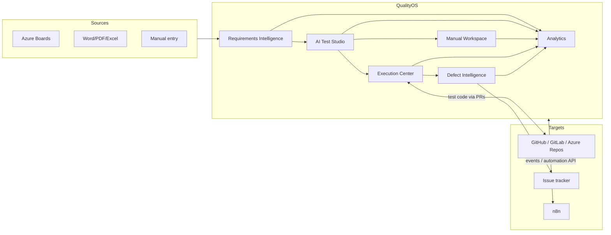

# 01 — Executive Summary

> Status: **Planned** — no feature described in this package is implemented yet · Audience: owner, future company sponsors · Last reviewed: 2026-11-09

## What QualityOS is
QualityOS is an internal quality-engineering platform for running software testing across many projects. It joins requirements, test design, manual testing, automated testing, defect handling, and quality reporting into one traceable system, and uses AI to make each step faster.

It does **not** depend on any particular vendor. Each project can configure its own:
- source-control provider: GitHub, GitLab, Azure Repos, or local Git
- requirements sources: Azure Boards, Word, PDF, Excel, or manual entry
- issue tracker: Azure Boards, GitHub, GitLab, or the internal tracker
- CI system
- AI model
- storage backend

## Why
The target organization tests mostly by hand. Its requirements live in Azure Boards and its code in GitLab. That leads to four problems:
- Regression testing is repetitive and expensive.
- How well tests are designed varies from engineer to engineer.
- Bug reports take a long time to write.
- Nobody can easily trace a requirement through its tests and defects to the fix.

QualityOS goes after each of these. It **measures** the improvement rather than assuming it ([29](29-business-case-and-kpis.md)).

## How (architecture in one paragraph)
QualityOS is a **modular monolith** written in TypeScript (NestJS API and workers, Next.js UI). It is deployed as a few cooperating processes, and **PostgreSQL is the single source of truth** for data and background jobs (pg-boss). Every external system sits behind a **provider port with a capability manifest**, so changing providers is a configuration change that keeps history intact. **n8n** is the only engine for configurable workflows, and the core owns state, rules, and a small, closed set of essential operations ([ADR-0017](adr/ADR-0017-orchestration-ownership.md)). Automated tests run in **isolated, ephemeral Playwright containers** started by a dedicated execution controller. AI runs as **bounded, versioned tasks** through a gateway that enforces redaction, budgets, schema validation, and human approval.

## Delivery approach
Fourteen phases ([25](25-implementation-roadmap.md)), each of which ends in a working, verifiable increment:
1. **Foundations, P0 to P2.** Spikes, the platform skeleton, identity, projects, and the provider framework with demo-mode mock adapters.
2. **First value for manual QA, P3 and P4.** Requirements ingestion from any source, structured test cases, and a manual execution workspace.
3. **Automation and intelligence, P5 to P9.** AI test design, sandboxed execution, n8n orchestration, defect intelligence with issue sync, test code generation through PRs, and visual regression.
4. **Measurement and hardening, P10 and P11.** Analytics and KPIs, then security, reliability, and backup hardening.
5. **Pilot, P12.** Four to six weeks on the owner's personal projects, with baseline measurements and pre-set success criteria ([27](27-pilot-validation-plan.md)).
6. **Enterprise readiness, P13.** GitLab, Entra ID single sign-on, managed secrets, a server deployment, and multiple teams ([28](28-enterprise-rollout.md)).

## Key decisions at a glance
| Area | Decision | Record |
|---|---|---|
| Architecture | Modular monolith, hexagonal ports, multiple processes | [ADR-0001](adr/ADR-0001-modular-monolith.md), [ADR-0002](adr/ADR-0002-hexagonal-capabilities.md) |
| Data | PostgreSQL 17 + Drizzle; pgvector; outbox and inbox | [ADR-0005](adr/ADR-0005-postgres-drizzle.md), [ADR-0007](adr/ADR-0007-outbox-inbox.md) |
| Jobs | pg-boss, at-least-once delivery, idempotent consumers; no Redis | [ADR-0006](adr/ADR-0006-pg-boss-queue.md) |
| Orchestration | n8n is the single workflow engine; the core runs essential operations and a minimal fallback | [ADR-0008](adr/ADR-0008-n8n-orchestrator.md), [ADR-0017](adr/ADR-0017-orchestration-ownership.md) |
| Execution | Playwright in hardened ephemeral containers; engine and backend split | [ADR-0010](adr/ADR-0010-sandboxed-execution.md), [ADR-0018](adr/ADR-0018-test-engine-vs-execution-backend.md) |
| AI | Bounded tasks, AI gateway, human approvals; Claude first, replaceable | [ADR-0012](adr/ADR-0012-ai-gateway-bounded-tasks.md) |
| Storage | Local filesystem, then S3-compatible; MinIO rejected (maintenance mode) | [ADR-0011](adr/ADR-0011-object-storage.md) |
| Event ingress | Polling first, webhooks to cut latency | [ADR-0014](adr/ADR-0014-polling-first-ingress.md) |

## Top risks
1. **Too much scope for one builder.** Mitigated by phase gates that each deliver usable value. Manual QA value arrives at P4, before any AI.
2. **AI output quality and cost.** Mitigated by eval datasets, required approval, budgets, and measured precision ([15](15-ai-agent-architecture.md)).
3. **Flaky automation that erodes trust.** Mitigated by recording every retry, measuring flakiness, and never letting tests heal themselves silently.
4. **n8n license for company use.** This is an open legal question (OD-01). Because n8n sits behind a port, it can be replaced.
5. **Company security approval.** Mitigated by designing security in from day one ([21](21-security-architecture.md)). The pilot uses no company data.

Full risk register: [30](30-risks-and-mitigations.md).

## What we ask of a future sponsor
After the pilot: review the measured results against the success criteria in [27](27-pilot-validation-plan.md), then approve a limited company pilot with one project and one QA team on GitLab and Azure Boards, under the security and legal preconditions in [28 §2](28-enterprise-rollout.md).
