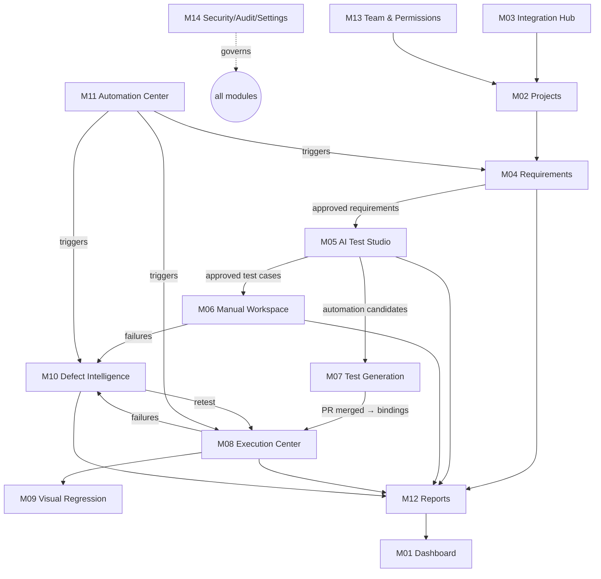

# 02 — Product Vision

> Status: **Planned** · Owner: Product Manager · Last reviewed: 2026-11-09

## Vision statement
> Every project in the company has one trustworthy, traceable record of quality, from requirement to verified fix. AI assists the QA professionals who own it. It does not replace them.

## Product principles
1. **Humans approve, AI proposes.** Any AI output that would change authoritative state needs a human decision, unless an explicit project policy allows otherwise. AI confidence is never treated as proof that something is correct.
2. **Manual and automated testing are first-class citizens of the same model.** A test case can be manual today and automated tomorrow. Its history, traceability, and results stay continuous.
3. **Source-independent quality workflow.** Once a requirement is approved, the downstream QA workflow is identical whatever the source: Azure Boards, a PDF, Excel, or manual entry.
4. **Provider-agnostic by construction.** No business rule mentions GitHub, GitLab, Azure, n8n, or Claude. Providers are capabilities bound per project.
5. **Evidence over assertion.** Every result, defect, and metric links to its evidence (artifacts, logs, provenance) and states whether it was measured or estimated.
6. **Trustworthy results.** Runs are immutable once finalized. Retries are visible, never hidden. Baselines and assertions never change silently.
7. **Local-first, enterprise-ready.** QualityOS runs fully on one machine. The same architecture moves to a company server with configuration, not a redesign.
8. **Calm, dense, fast UX.** It is built for QA engineers who spend all day in it: keyboard-first, information-dense, and with clear status.

## Target users
Detailed in [04](04-personas-and-user-journeys.md): QA Lead, QA Engineer (manual-first), Automation Engineer, QC Reviewer, Developer, Project Manager, Executive Stakeholder, Platform Admin.

## Product scope (full vision)
| Capability area | Modules |
|---|---|
| Visibility | [M01 Company Dashboard](modules/M01-company-dashboard.md), [M12 Reports & Analytics](modules/M12-reports-analytics.md) |
| Configuration | [M02 Project Management](modules/M02-project-management.md), [M03 Integration Hub](modules/M03-integration-hub.md), [M13 Team & Permissions](modules/M13-team-permissions.md), [M14 Security, Audit & Settings](modules/M14-security-audit-settings.md) |
| Requirements | [M04 Requirements Intelligence Center](modules/M04-requirements-intelligence.md) |
| Test design | [M05 AI Test Studio](modules/M05-ai-test-studio.md) |
| Testing | [M06 Manual Testing Workspace](modules/M06-manual-testing-workspace.md), [M07 Automated Test Generation](modules/M07-automated-test-generation.md), [M08 Test Execution Center](modules/M08-test-execution-center.md), [M09 Visual Regression](modules/M09-visual-regression.md) |
| Defects | [M10 AI Defect Intelligence](modules/M10-defect-intelligence.md) |
| Automation | [M11 Automation Center](modules/M11-automation-center.md) |

## Module relationship map

## What "done" looks like
- **Personal pilot success**: the measured criteria in [27 §6](27-pilot-validation-plan.md).
- **Company rollout success** (12 months after adoption, targets to be agreed with sponsors from the pilot baseline):
  - Requirement-to-test traceability coverage of 80% or more on adopted projects.
  - Regression suites run on every release candidate.
  - Median time to prepare a bug report reduced versus the baseline.
  - QA teams on at least 3 projects actively using the platform.

## Out of scope
Listed in [31 §3](31-assumptions-and-open-decisions.md).
