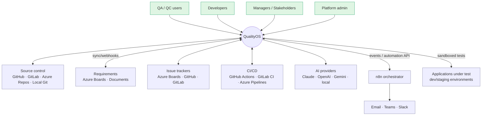
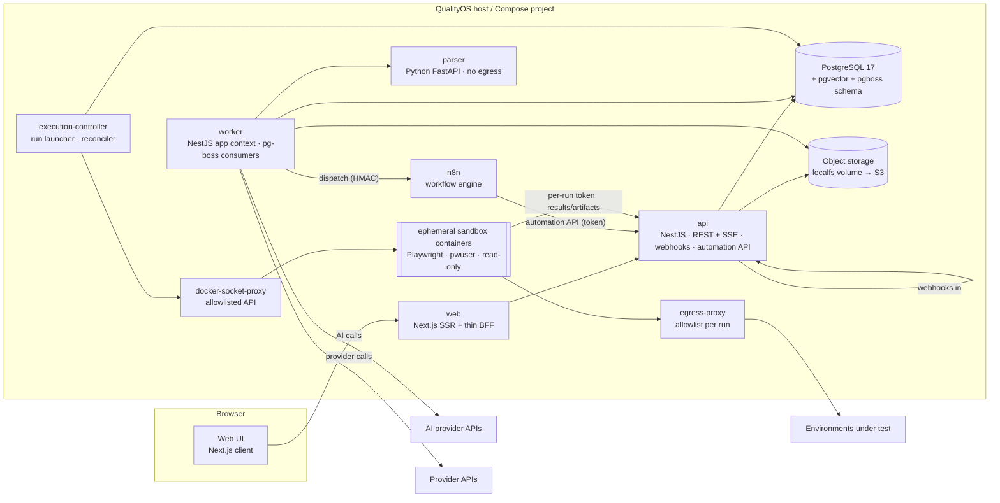
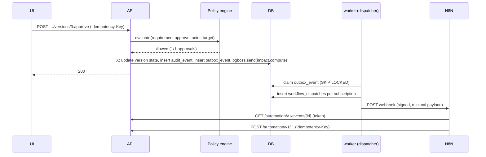
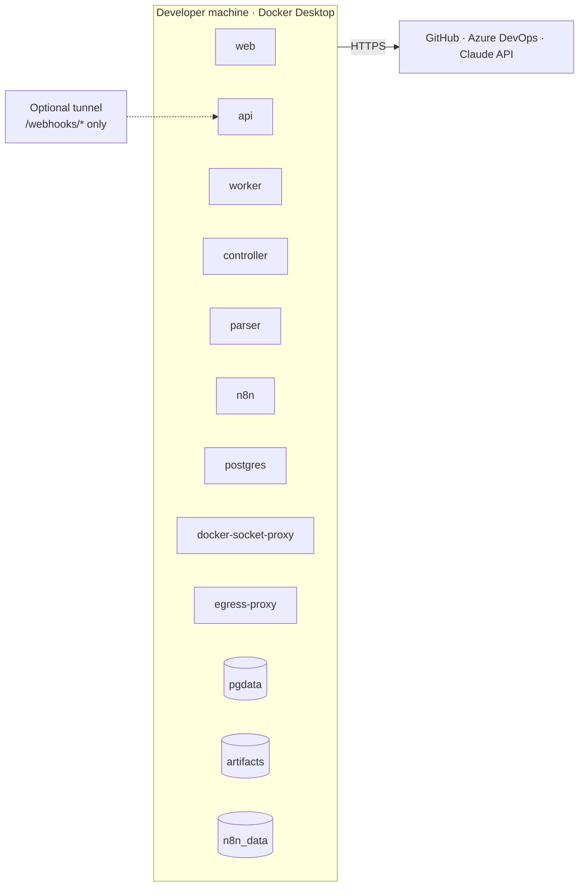

# 07 — System Architecture

> Status: **Planned** · Owner: Principal Architect · Decisions: [ADR-0001](adr/ADR-0001-modular-monolith.md) … [ADR-0018](adr/ADR-0018-test-engine-vs-execution-backend.md)

## 1. Architectural style
- **Modular monolith** with **hexagonal (ports & adapters)** boundaries and **clean architecture** layering inside each module.
- **One codebase, several processes** (api, worker, execution-controller, web) plus a Python parser sidecar.
- **PostgreSQL is the single source of truth.** It holds domain state, the job queue, the outbox/inbox, audit, and vectors.
- **Event-driven integration:** a transactional outbox sends domain events to internal subscribers and to the workflow orchestrator.
- **Microservices were evaluated and rejected for now** ([ADR-0001](adr/ADR-0001-modular-monolith.md)). The path to extract services later is kept open by module boundaries and event contracts.

## 2. System context (C4 level 1)


## 3. Containers (C4 level 2)


| Container | Responsibilities | Talks to | Must never |
|---|---|---|---|
| `web` | Rendering, session cookie handling, BFF proxy | `api` | Access DB, providers, or contain business rules |
| `api` | Auth, RBAC, REST/SSE APIs, webhook ingress (separate listener port), Automation API, internal sandbox upload API | DB, storage, pg-boss (enqueue) | Run long jobs, call AI synchronously beyond 30 s, reach Docker |
| `worker` | All class-E jobs except run launching: sync, inbox processing, parse orchestration, AI tasks, outbox dispatch, analytics, maintenance | DB, storage, parser, provider APIs, AI APIs, n8n webhooks | Reach Docker |
| `execution-controller` | Consume run jobs, launch/monitor/cancel sandboxes, reconcile, finalize | DB, storage (via API upload path), docker-socket-proxy | Hold provider admin tokens (only mints per-run tokens via API) |
| `parser` | Parse documents to `ParsedDocument` | Called by worker | Any outbound network |
| `n8n` | Execute workflow templates | QualityOS Automation API, notification channels | Access DB |
| sandbox | Run untrusted tests | Egress proxy (allowlist), API internal upload (token) | Reach host, DB, Docker, other sandboxes |

## 4. Logical modules (inside api/worker/controller)
```mermaid
flowchart TB
  subgraph Platform kernel
    ID[identity]
    AUD[audit]
    SEC[secrets]
    POL[policy/approvals]
    NOT[notifications]
    STO[storage]
    JOB[jobs/outbox/inbox]
  end
  subgraph Domain modules
    PRJ[projects]
    INT[integrations]
    REQM[requirements]
    TM[testmgmt]
    EXE[execution]
    VIS[visual]
    DEF[defects]
    AIM[ai]
    AUTO[automation]
    ANA[analytics]
  end
  PRJ --> INT
  REQM --> INT
  REQM --> AIM
  TM --> REQM
  TM --> AIM
  EXE --> TM
  EXE --> INT
  VIS --> EXE
  DEF --> EXE
  DEF --> INT
  DEF --> AIM
  AUTO --> EXE
  AUTO --> DEF
  ANA -.reads projections.-> REQM & TM & EXE & DEF
  Domain modules --> Platform kernel
```

**Dependency rules** (enforced by dependency-cruiser):
1. `domain` layers import only their own module's domain plus `@qos/kernel-domain` (shared value objects: IDs, Money, ExternalRef, ProjectScope).
2. A module may call another module only through its **application service interface** exported from `index.ts`. It must never import another module's repositories or schema.
3. Cross-module reactions go through domain events (outbox), which keeps module dependencies one-way.
4. Adapters live in `packages/adapters-*` and implement ports from `@qos/ports`. Modules depend on ports, never on adapters.
5. Only `apps/*` composition roots wire adapters to ports (Nest DI).

### Layering inside a module
```
modules/requirements/
  domain/        entities, value objects, domain services, events (no framework)
  application/   use cases (commands/queries), port interfaces it needs, DTO mapping
  infrastructure/ Drizzle repositories, job handlers, adapter glue
  api/           Nest controllers, request/response schemas from @qos/contracts
  index.ts       public application service + event types only
```

## 5. Key runtime flows (sequence)
### 5.1 Command with event (e.g. approve requirement version)


### 5.2 Automated run
See [17 §4](17-test-execution-engine.md) for the full sequence and state machine.

## 6. Repository layout (planned; not scaffolded)
```
qualityos/
  apps/
    api/                 NestJS HTTP composition root
    worker/              NestJS application-context composition root (pg-boss consumers)
    execution-controller/ NestJS app-context; Docker client (via proxy)
    web/                 Next.js App Router
  services/
    parser/              Python FastAPI (uv, pyproject)
    sandbox-entrypoint/  small Node program baked into the sandbox images (clone → install → run → upload; see 17 §6)
  packages/
    contracts/           Zod schemas: API, events, AI outputs, RunSpec; OpenAPI + JSON Schema export
    kernel-domain/       shared value objects
    domain/              (optional umbrella) or per-module domain packages
    ports/               port interfaces + capability catalog
    adapters-github/ adapters-gitlab/ adapters-azure-devops/ adapters-local-git/
    adapters-ai-anthropic/ adapters-ai-openai/ adapters-ai-gemini/ adapters-ai-openai-compatible/
    adapters-storage-localfs/ adapters-storage-s3/
    adapters-orchestrator-n8n/
    adapters-engine-playwright/ adapters-backend-docker/ adapters-backend-ci/
    adapters-mock/       mock adapters for every port (demo mode + tests)
    contract-tests/      shared port contract suites
    modules/             domain modules (identity, projects, integrations, requirements, …)
    ui/                  design system (tokens, components) on shadcn/ui
    prompts/             versioned prompt templates + eval datasets
    config/              eslint, tsconfig, dependency-cruiser rules
  infra/
    compose/             docker-compose.yml, profiles (core, n8n, exec, observability), env templates
    n8n/workflows/       workflow templates JSON (stable IDs)
    images/              sandbox image Dockerfiles (Playwright + fonts), parser image
    scripts/             backup, restore, n8n import/export, seed
  fixtures/
    demo-app/            small web app with seeded bugs for E2E/demo
    documents/           parser corpus (EN/AR)
    provider-recordings/ recorded API fixtures per adapter
  docs/planning/         this package
```
Sandbox images are built from `infra/images/sandbox`. Each one is layered on the official Playwright image for a supported version and adds `sandbox-entrypoint`, the Arabic/CJK font packages, and `git`. No code is copied in from the host at runtime ([17 §6](17-test-execution-engine.md)).

## 7. Cross-cutting mechanisms
| Concern | Mechanism | Detail |
|---|---|---|
| Project isolation | `ProjectScope` value required by every repository method; policy guard resolves scope; optional RLS | [21 §4](21-security-architecture.md) |
| Idempotency | `Idempotency-Key` middleware + `idempotency_keys` table; expected-state updates in consumers | [22 §4](22-observability-and-reliability.md) |
| Audit | Nest interceptor + domain-level `audit()` in use cases inside the same TX | [M14](modules/M14-security-audit-settings.md) |
| Events | Outbox in TX; dispatcher; at-least-once; `event_id` dedupe | [19 §1](19-workflow-specifications.md) |
| Long operations | `operations` table (id, type, status, progress, result ref) + SSE | FR-X-07 |
| Configuration | 12-factor env + typed config schema validated at boot; secrets via files | [23](23-local-deployment.md) |
| Feature flags | `system_settings.features` + per-project overrides; simple boolean/percentage | [M14](modules/M14-security-audit-settings.md) |
| i18n | next-intl (UI), ICU messages; API returns codes + params, not localized strings | [20 §9](20-ui-ux-architecture.md) |

## 8. Deployment views
- Local (pilot): [23](23-local-deployment.md)
- Enterprise: [28 §3](28-enterprise-rollout.md)



## 9. Architectural fitness functions (CI-enforced)
1. dependency-cruiser: no cross-module imports except public `index.ts`; domain has no `@nestjs/*`, `drizzle-orm`, or adapter imports.
2. Lint rule: no string literals matching provider type names (`'github'|'gitlab'|'azure'|'n8n'|'anthropic'|'playwright'`) in `packages/modules/**` outside `infrastructure/` mapping files.
3. Route permission declaration test (M13-AC-01).
4. Contract test suites pass for every registered adapter.
5. Migration check: every Drizzle schema change has a committed migration; `drizzle-kit check` is clean.
6. OpenAPI diff check on PRs: breaking API changes require a version bump.
