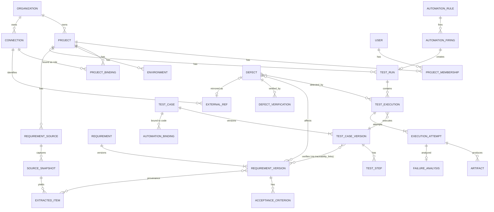
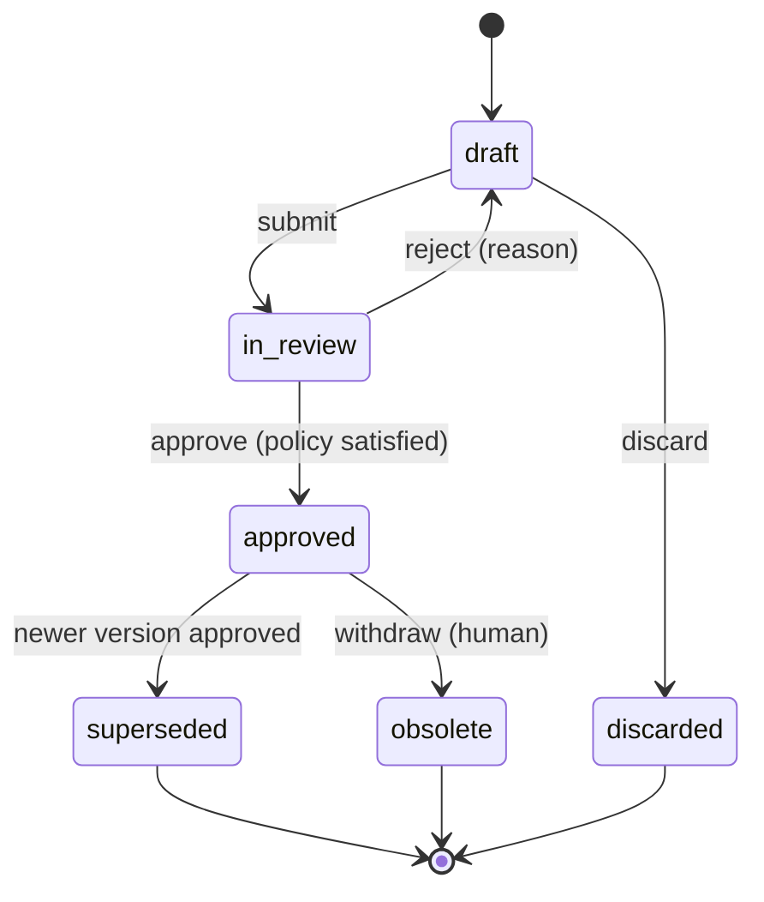
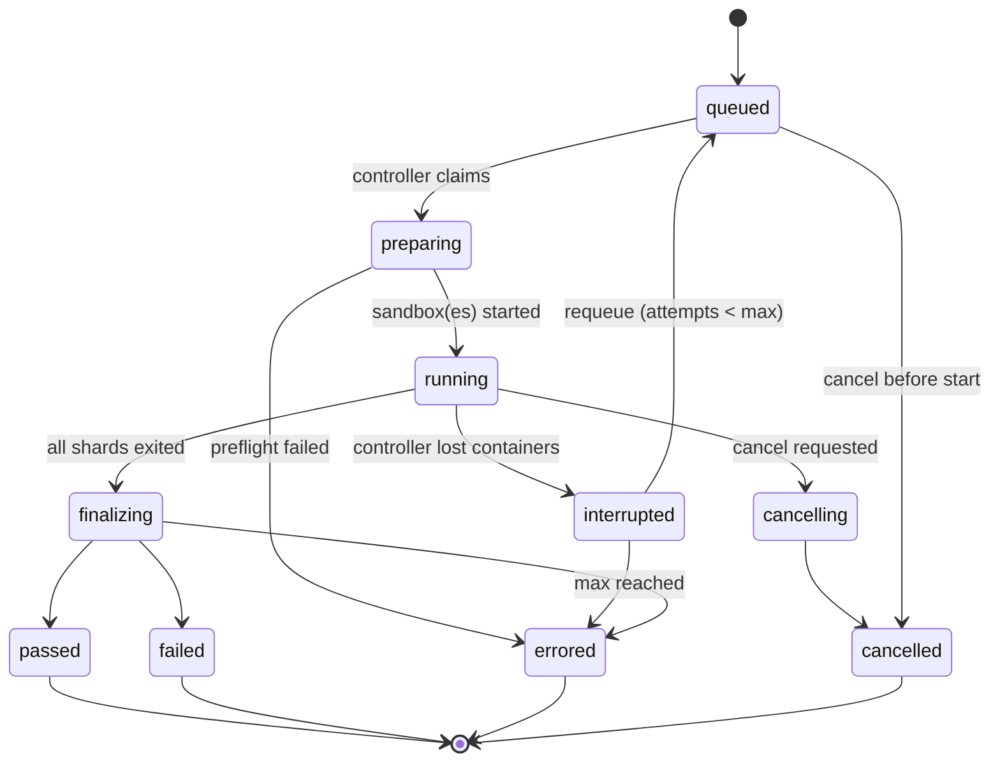
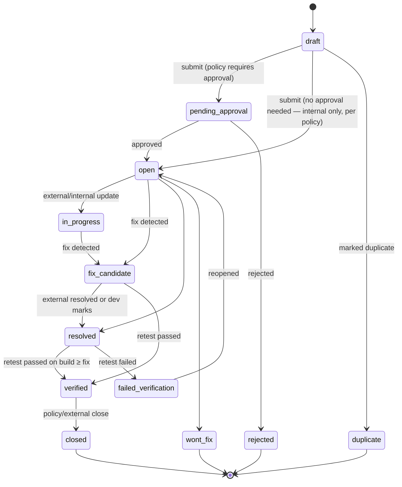

# 09 — Domain Model

> Status: **Planned** · Owner: Principal Architect + Database Architect · Physical design: [10](10-database-design.md) · Glossary: [34](34-glossary.md)

## 1. Bounded contexts
| Context (module) | Core aggregates | Upstream of | Downstream of |
|---|---|---|---|
| Identity & Access | User, Membership, Role, ServiceAccount, ApiToken | all | — |
| Projects | Project, Environment, ProjectBinding, ProjectSettings | all domain modules | Integrations (connections) |
| Integrations | Connection, ExternalRef, SyncCursor, InboxMessage, Mapping | Requirements, Execution, Defects, Automation | — |
| Requirements | RequirementSource, SourceSnapshot, Requirement (+Versions, AC), Finding | Test Management, Analytics | Integrations, AI |
| Test Management | TestCase (+Versions, Steps), Suite, Cycle | Execution, Analytics | Requirements, AI |
| Execution | TestRun (+Executions, Attempts, Results), RunManifest, QualityGate, AutomationBinding | Defects, Visual, Analytics | Test Management, Integrations |
| Visual | VisualCheckpoint, VisualBaseline, VisualComparison | Defects | Execution |
| Defects | Defect, DefectDraft, FailureAnalysis, FailureCluster, Verification | Analytics, Automation | Execution, Integrations, AI |
| AI | AiTask (catalog), AiExecution, AiSuggestion, PromptVersion, Budget | Requirements, TestMgmt, CodeGen, Defects, Analytics | — |
| Code Generation | CodeGenerationJob, CodeChange | Execution (bindings) | TestMgmt, Integrations, AI |
| Automation | AutomationRule (+Versions), Firing, Dispatch, AutomationRun | Execution, Defects, Reports | Outbox (all) |
| Governance | AuditEvent, ApprovalPolicy, ApprovalRequest, Secret, RetentionPolicy, Notification | all | — |
| Analytics | KpiDefinition, MetricSnapshot, ReportDefinition, ReportInstance | Dashboard | all (read models) |

## 2. Core entity relationships (conceptual ER)

## 3. Aggregates, invariants, and lifecycles

### 3.1 Requirement
- **Aggregate root:** `Requirement`. It holds a stable key and current pointers: `effectiveVersionId` (latest approved) and `latestVersionId`.
- **Invariants:**
  - `RequirementVersion` is immutable once created, except for its `state` field and approval references.
  - At most one version is `approved` and effective at a time. The earlier approved version becomes `superseded`.
  - Every version has ≥ 1 provenance link.
  - Approval is blocked while open conflicts exist (BR-M04-6).
- **Version state machine:**

- The requirement-level flag `source_removed` is set when the source item disappears. It changes nothing automatically.

### 3.2 TestCase
- **Root:** `TestCase`, with `TestCaseVersion` (immutable after approval) holding the steps.
- **Version states:** `draft → in_review → approved → superseded | retired`. The rules mirror Requirement.
- **Automation status:** a separate state machine: `manual_only | candidate | in_progress | automated | automation_broken | retired`. `automated` is set only by binding activation.
- **Coverage links:** `traceability_links(type='verifies', from=test_case_version, to=requirement_version, ac_id?)`. A link becomes `outdated` when the requirement version is superseded.

### 3.3 TestRun / Execution / Attempt / Result
- **Root:** `TestRun`. It contains `TestExecution` (one per test case and parameter set), and each execution has one or more `ExecutionAttempt`s.
- **Run state machine:**

- **Immutability:** once a run is in a terminal state, its executions, attempts, results, and manifest are read-only. Reclassification and comments live in `annotations`.
- **Status derivation per execution:** first attempt passed → `passed`. Some attempt failed and a later attempt passed → `flaky`. All attempts failed → `failed`. Errors without assertions → `errored`. Not executed → `not_run` / `skipped` / `cancelled`.
- Manual runs use the same model with `kind='manual'`. An attempt maps to an execution pass or a reopen.

### 3.4 Defect
- **Root:** `Defect`, with `DefectDraft` (a candidate that is not yet a defect), `DefectVerification`, and state history.
- **Lifecycle:**

- **External sync** is a parallel state: `not_synced | pending | synced | failed | conflict | legacy_sync | stopped`.

### 3.5 AutomationRule / Firing
- **Invariant:** `UNIQUE(rule_id, slot_key)` on firings. A firing is created exactly once, by n8n or by the core fallback.
- **AutomationRun states:** `dispatched → running → completed | failed | timed_out → (retry) dispatched | dead_lettered`.

### 3.6 Connection / Binding / ExternalRef
- **Connection states:** `active | degraded | auth_failed | disabled | retired`.
- **Binding** is time-bounded. At most one binding per (project, role) is active, except for `requirements` and `notifications`.
- **ExternalRef** is unique on `(connection_id, external_type, external_id)`. A cross-connection identity check uses `(provider_type, external_instance, external_id)`, where `external_instance` is the org or host URL.

## 4. Events (domain event catalog, abridged)
The full envelope and payload rules are in [19 §1](19-workflow-specifications.md). Naming is `<aggregate>.<fact-in-past-tense>`.

| Context | Events |
|---|---|
| Projects | project.created, project.updated, project.binding.changed, project.archived, environment.changed |
| Integrations | connection.created, connection.tested, connection.health.changed, connection.credential.expiring, connection.retired, sync.completed, sync.failed, external.item.changed |
| Requirements | requirement.snapshot.ingested, requirement.extraction.completed, requirement.version.created, requirement.version.submitted, requirement.version.approved, requirement.version.superseded, requirement.finding.created, requirement.impact.detected |
| Test mgmt | testcase.version.created, testcase.version.approved, testcase.needs_review, testcase.automation.candidate_marked, ai.suggestions.ready, cycle.started, cycle.closed |
| Execution | run.requested, run.started, run.shard.completed, run.finalized, run.interrupted, test.failed, gate.evaluated, flaky.detected, execution.completed, execution.failed, execution.blocked, session.ended |
| CodeGen | codegen.job.completed, codegen.pr.opened, codegen.pr.merged, binding.activated, binding.broken |
| Visual | visual.diff.detected, visual.baseline.approved, visual.baseline.invalidated |
| Defects | failure.analyzed, defect.draft.created, defect.draft.approved, defect.created, defect.external.created, defect.state.changed, defect.fix_candidate, defect.verification.completed, defect.sync.conflict |
| Automation | automation.firing.created, automation.run.completed, automation.run.dead_lettered, orchestrator.status.changed |
| Governance | approval.requested, approval.decided, budget.threshold.reached, budget.exhausted, backup.completed, backup.failed, health.degraded, secret.rotated, secret.expiring |
| Analytics | analytics.snapshot.computed, report.generated |

## 5. Traceability graph
`traceability_links` is a typed, versioned edge table:

| type | from | to | Notes |
|---|---|---|---|
| `derived_from` | requirement_version | extracted_item | Provenance (also in `requirement_provenance`) |
| `child_of` | requirement | requirement | Hierarchy |
| `verifies` | test_case_version | requirement_version (+ac) | Coverage |
| `bound_to` | test_case | automation_binding | Code mapping |
| `executed_as` | test_case_version | test_execution | Implicit via FK; materialized for graph queries |
| `detected_by` | defect | test_execution / execution_attempt | |
| `affects` | defect | requirement_version | |
| `fixed_by` | defect | external_ref (commit/PR) | |
| `verified_by` | defect | test_execution | |
| `duplicates` | defect_draft/defect | defect | |
| `updates` | code_change | test_case_version | Generated code |

Each link records `created_by` (user, AI suggestion, or system), `created_at`, and `status` (`active` / `outdated` / `removed`). Removal is a soft state, so history queries can reconstruct coverage at any past time.

## 6. Identity and keys
- Primary keys are UUIDv7 everywhere.
- Human keys are `{PROJECT_KEY}-{TYPE}-{seq}`, from per-project, per-type sequences in `project_key_sequences` (row-locked increment). They are never reused.
- External identity uses `external_refs` only. No domain table stores raw provider IDs.

## 7. Value objects (kernel)
`ProjectScope`, `Id<T>`, `HumanKey`, `ExternalRefId`, `Money{amountMicros, currency}`, `TokenUsage`, `Locator{kind: page|section|cell|field, …}`, `Confidence(0..1)`, `Severity`, `Priority`, `ContentHash`, `SlotKey`, `IdempotencyKey`, `CorrelationId`.

## 8. Similarity search strategy
- **Embeddings:** pgvector `vector(n)` columns in `*_embeddings` tables (requirements, test cases, defects), each with the model ID and dimensions. HNSW index with cosine distance. These tables live per project in a shared table with a `project_id` filter. Queries always filter on `project_id` first (B-tree), then rank by vector. Projects are small enough for exact re-ranking.
- **Fallback (OD-06):** without pgvector or embeddings, `pg_trgm` trigram similarity on normalized text plus signature heuristics. Quality is lower and is flagged in the UI.
- **Arabic normalization:** applied before embedding and trigram indexing ([14 §8](14-requirements-engine.md)).
