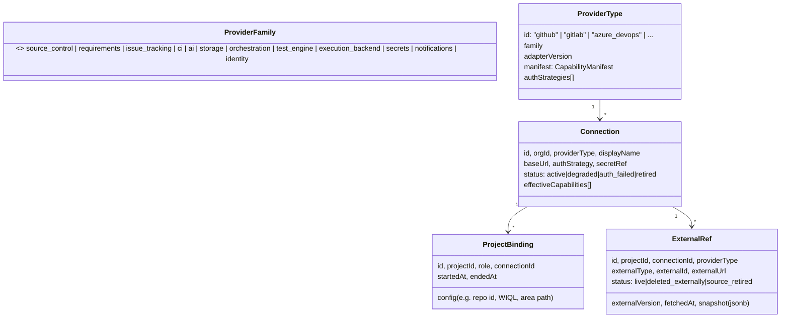

# 11 — Provider Architecture

> Status: **Planned** · Owner: Enterprise Integration Architect · Decisions: [ADR-0002](adr/ADR-0002-hexagonal-capabilities.md), [ADR-0018](adr/ADR-0018-test-engine-vs-execution-backend.md) · Contracts: [12](12-provider-contracts.md) · Matrix: [33](33-provider-compatibility-matrix.md)

## 1. Goals
1. Every project can use a different provider for each family, at the same time.
2. Business logic never references a provider type.
3. Capability differences are explicit, discoverable, and degrade gracefully.
4. Switching providers keeps historical records and traceability.
5. Every provider can be replaced by a mock, so demo mode and CI work without credentials.

## 2. Concepts


- **Provider family**: a kind of external capability. Each family has one port interface. Some families have several (source control has `RepositoryProvider`, and webhooks are handled by the shared `WebhookVerifier`).
- **Provider type**: a concrete adapter, registered in code with a static **capability manifest**.
- **Connection**: an organization-level configured instance holding credentials and base URL. One Azure DevOps connection can serve as both the requirements source and the issue tracker for several projects.
- **Project binding**: assigns a connection to a **role** in a project, plus role-specific config. Bindings are time-bounded (`started_at`, `ended_at`). History is never overwritten.
- **ExternalRef**: the provider-neutral handle to every external object QualityOS knows: work item, issue, commit, PR, pipeline run, document file. Domain entities hold `external_ref_id`, never raw provider IDs.

## 3. Roles per project
| Role | Family | Cardinality | Default |
|---|---|---|---|
| `repository` (application code) | source_control | 0..1 | none |
| `test_repository` | source_control | 0..1 (same as `repository` in `app_repo_folder` mode) | none |
| `requirements` | requirements | 0..n | manual source always available |
| `issue_tracker` | issue_tracking | 1 | **internal** |
| `ci` | ci | 0..1 | none (local execution) |
| `ai` | ai | 0..1 | org default |
| `orchestrator` | orchestration | org-level | n8n connection or `null` (essential-only mode) |
| `storage` | storage | org-level | localfs |
| `execution_backend` | execution_backend | 1..n (per trigger type) | local_docker |
| `test_engine` | test_engine | 1 | playwright |
| `notifications` | notifications | 0..n | in-app |
| `secrets` | secrets | platform-level | db_envelope |
| `identity` | identity | platform-level | local |

## 4. Registry and resolution
```mermaid
sequenceDiagram
  participant UC as Use case (e.g. PushDefect)
  participant REG as ProviderRegistry
  participant DB
  participant AD as Adapter (e.g. AzureBoardsIssueTracker)
  UC->>REG: resolve(projectId, role="issue_tracker", require=["issues.create@1"])
  REG->>DB: active binding + connection + effective capabilities
  REG->>REG: check capability; build adapter with ConnectionContext (secrets via SecretStore, rate limiter, http client w/ SSRF guard)
  REG-->>UC: IssueTracker port instance (or CapabilityMissingError)
  UC->>AD: createIssue(canonicalIssue, idempotencyKey)
  AD-->>UC: ExternalRefData
  UC->>DB: persist ExternalRef + domain change (TX)
```

- The registry caches adapter instances per connection for 5 minutes and invalidates on `connection.updated`.
- `ConnectionContext` gives adapters only what they need:
  - a logger with redaction
  - an outbound HTTP client with the SSRF guard, retries, and a rate-limit budget per connection
  - a secret accessor scoped to the connection
  - a clock
  - metrics

## 5. Capability model
- Capabilities are named `family.object.verb@major` (e.g. `issues.create@1`, `repo.pr.create@1`, `requirements.revisions@1`). The full catalog is in [12 §2](12-provider-contracts.md).
- **Static manifest**: the capabilities and limits an adapter implements, such as `maxAttachmentBytes`, `supportsRichText: 'markdown'|'html'`, `rateLimitHint`, `fieldTypes[]`.
- **Effective capabilities** = static manifest ∩ permission probe results ∩ admin-disabled list. Stored per connection and recomputed on test.
- Each binding role declares **required** and **optional** capabilities ([12 §3](12-provider-contracts.md)).
- **Degradation policy**: every optional capability has a defined fallback in the calling use case (e.g. no `issues.attachments.create`, so evidence links go in the description). Fallbacks are tested in the mock adapter by toggling capabilities.

## 6. Provider switching and historical integrity
Principles:
1. **Append, don't rewrite.** Switching a binding ends the old binding (`ended_at`) and starts a new one. Existing ExternalRefs keep their `connection_id`.
2. **Snapshots preserve history.** Each ExternalRef stores a minimal snapshot (title, state, URL, key fields) at its last fetch. When the connection is retired, the UI renders from the snapshot with the label "source retired".
3. **Mapping old to new (optional).** For repository moves (e.g. a GitHub repository mirrored to GitLab), a `ref_mappings` table maps old commit SHAs and branch names to new ones. A commit SHA stays the same across a mirror, which lets impact analysis continue. PR/MR numbers are not mapped; they stay historical.
4. **Open items in the old tracker.** When the issue tracker changes, open defects keep their old external link, with a choice:
   - keep syncing the old tracker until closed: allowed while the old connection is active, and the binding is set to `legacy_sync` mode
   - stop syncing
   - recreate the issue in the new tracker, with a cross-reference comment where possible
5. **Audit** records the switch, its validation results, and any mappings.

The full flow, failure handling, and rollback are in [19 WF-F](19-workflow-specifications.md).

## 7. Adapter implementation rules
- An adapter is pure translation: provider DTO ↔ canonical model. It has **no business rules** (e.g. it never decides severity).
- Errors are normalized to a `ProviderError` taxonomy: `auth_failed`, `permission_denied`, `not_found`, `conflict`, `rate_limited(retryAfter)`, `validation(field)`, `unavailable`, `timeout`, `unknown`. Each carries the provider error code and a sanitized message.
- Pagination, rate limiting, and retries live inside the adapter, through `ConnectionContext` helpers.
- Webhook verification is a separate `WebhookVerifier` per provider type: GitHub HMAC, GitLab token, Azure Basic auth + re-fetch, and none for local Git.
- Text formatting goes through `RichTextConverter` (canonical Markdown ↔ Azure HTML / GitHub Markdown / GitLab Markdown).
- Every adapter ships a recorded-fixture test set and passes its family's contract suite.

## 8. Mock adapters (demo mode & tests)
- `adapters-mock` implements every port, backed by in-memory or DB-backed fake state, with deterministic data seeded from `fixtures/`.
- Mocks support **capability toggles** (to test degradation), **fault injection** (rate limits, 5xx, timeouts, partial pages), and **webhook emission** (to exercise inbox and dedupe).
- Demo mode binds a sample project to mock connections for every role. Mock connections are labelled "Demo" in the UI and can never be bound to non-demo projects.

## 9. Adding a new provider (procedure)
1. Create `packages/adapters-<provider>` implementing the port(s).
2. Write the manifest and auth strategies, and register them in the provider catalog.
3. Record fixtures with a throwaway account and scrub them.
4. Pass the shared contract suite (`packages/contract-tests/<family>`).
5. Add mapping defaults (statuses, fields).
6. Document required scopes in [13](13-integration-design.md) and add a row to [33](33-provider-compatibility-matrix.md).
7. No changes to `packages/modules/**` should be needed. If a change is needed, a capability is missing: propose it through an ADR.
