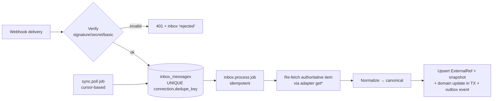

# 13 — Integration Design (per provider)

> Status: **Planned** · Owner: Enterprise Integration Architect · Facts: [36](36-technical-validation.md) · Contracts: [12](12-provider-contracts.md)

This document holds the provider-specific details: authentication, scopes, sync mechanics, webhooks, mappings, rate limits, and limitations. Nothing here leaks into core modules.

## 1. Common ingestion pipeline

- **Webhooks never carry authority.** Webhook payloads are used to *locate* items. The processor then calls `get*` for the current state, unless the provider signs payloads **and** the payload is complete for that event type. In that case re-fetching is optional (an optimization), and it is still done for state transitions.
- **Polling is always on** ([ADR-0014](adr/ADR-0014-polling-first-ingress.md)). Default intervals: requirements 5 min, issues 5 min, commits 2 min, deployments 2 min. Each interval is adjustable within the rate budget.
- **Dedupe key priority:** the provider delivery ID header; otherwise `sha256(event type + item id + item version/updated_at)`.
- **Out-of-order deliveries:** we compare `externalVersion`/`updatedAt` and ignore older versions (inbox status `stale`).

## 2. GitHub (pilot: source control, optionally issues)
| Aspect | Design |
|---|---|
| Auth (pilot) | **Fine-grained PAT** limited to selected repositories. Permissions: Contents **read** (app repo), Contents **read & write** + Pull requests **read & write** (test repo only, for M07), Metadata read, Issues read & write (only if used as the tracker), Commit statuses write (optional for `repo.checks.report`). Pilot alternative: two PATs (read-only for the app repo, write for the test repo) to minimize blast radius |
| Auth (enterprise) | **GitHub App**: installation tokens (short-lived), per-repo permissions, and webhook secret on the app |
| Clone credential for sandbox | Read-only token. With a GitHub App, an installation token scoped `contents:read` to one repository with a 1 h TTL. With a PAT, the PAT cannot be down-scoped, so QualityOS **proxies the clone** instead: the API streams a `git archive`/tarball of the commit to the sandbox via the internal upload/download endpoint, and the sandbox never sees the PAT |
| Webhooks | Events: `push`, `pull_request`, `issues`, `issue_comment`, `deployment_status`, `workflow_run`. HMAC-SHA256 via `X-Hub-Signature-256` (constant-time compare). Dedupe via `X-GitHub-Delivery` |
| Polling | Commits: `GET /repos/{o}/{r}/commits?sha=&since=`. PRs: list sorted by updated. Issues: `since=` param. Deployments/workflow runs: list endpoints |
| Rate limits | Respect `x-ratelimit-remaining`/`reset` and secondary limits (backoff on 403 with `retry-after`) |
| Stable IDs | Repository numeric `id` (rename/transfer safe), PR `number` + repository id, issue `number` + repository id, commit SHA |
| Rich text | Markdown |
| Fix detection | Commit message patterns `Fixes|Closes|Resolves PRJ-D-n` plus GitHub's `#n` for GitHub Issues trackers |
| Limitations | Issue "types" are limited (labels used for type/severity mapping). No native severity field, so labels are used: `severity:S2`, `priority:P1` |

## 3. Azure DevOps (pilot: Boards requirements + Boards issues; enterprise: also Repos/Pipelines)
| Aspect | Design |
|---|---|
| Auth strategies | `pat` (pilot): **organization-scoped** PAT (global PATs rejected, A4). Scopes: Work Items **Read** (requirements only) or **Read & Write** (issue sync); Code Read (if Azure Repos); Build Read & Execute (if Pipelines). The expiry date is captured and warned about (A3). `entra_client_credentials` (enterprise): Entra app/service principal added to the Azure DevOps org with the minimum access level; certificate credential preferred; tokens (~1 h) cached in memory only (A2). **Legacy Azure DevOps OAuth is not supported** (A1) |
| Requirements sync | WIQL query (user-defined or generated from area/iteration/type filters) + `System.ChangedDate > cursor`, ordered by ChangedDate, paged (WIQL returns IDs; batch get work items with `$expand=relations`). Snapshot `externalVersion = System.Rev` |
| Field mapping defaults | Title ← `System.Title`; Description ← `System.Description` (HTML → sanitized → Markdown); AC ← `Microsoft.VSTS.Common.AcceptanceCriteria` (HTML list → items); State ← `System.State`; Tags ← `System.Tags`; Area/Iteration ← paths; Priority ← `Microsoft.VSTS.Common.Priority`; links ← relations (`System.LinkTypes.Hierarchy-Forward/Reverse`, `Related`) |
| Process templates | Agile (User Story), Scrum (Product Backlog Item), Basic (Issue), CMMI (Requirement) → work item type mapping selected at binding time; `issues.metadata.read` discovers states and required fields per type |
| Issue creation | JSON Patch `POST …/workitems/$Bug` (type from mapping); marker `[QOS:PRJ-D-n]` in `System.Description` **and** a tag `qos-PRJ-D-n` for `searchByMarker` via WIQL `[System.Tags] CONTAINS 'qos-PRJ-D-n'`; Repro steps ← `Microsoft.VSTS.TCM.ReproSteps` (HTML); Severity ← `Microsoft.VSTS.Common.Severity` (mapping S1–S4 → "1 - Critical"…); optimistic concurrency with `test /rev` op on update |
| Webhooks (service hooks) | Events: Work item created/updated/deleted (and Code pushed, PR created/updated, Build completed for Repos/Pipelines). **Unsigned** (A5) → Basic auth credential unique per connection, **HTTPS required** (so only through a tunnel with TLS in the pilot), plus a random path secret `/webhooks/{connectionId}/{pathSecret}`. Handler extracts the work item id + rev, then **re-fetches**. Dedupe key = `subscriptionId + notificationId` if present, else hash(id + rev + eventType) |
| Rate limits | Azure DevOps throttling via `Retry-After` and `X-RateLimit-*` headers → honour; keep request concurrency per connection ≤ 4 |
| Stable IDs | Work item `id` (org-unique); revision `rev`; project GUID; repository GUID |
| Fix detection | `AB#1234` syntax in commit messages (GitHub ↔ Azure Boards convention) and `Fixes PRJ-D-n`; Azure Repos commit–work item links via relations (`ArtifactLink`) |
| Limitations | Rich text is HTML (sanitize both directions). Custom required fields vary per org → mapping UI requires defaults. MSA-backed personal orgs may not work with Entra auth → use PAT (A7) |

## 4. GitLab (enterprise: source control + issues + CI)
| Aspect | Design |
|---|---|
| Auth | **Project/group access tokens** (preferred over personal tokens) with minimal scopes: `read_repository` (app repo), `read_api`; `write_repository` + `api` limited to the QA test project for MR creation (or a dedicated bot user with Developer role on the QA project only). Self-managed base URL supported (AS-15) |
| Clone credential | Short-lived project access token is not mintable on demand by default → use **deploy token** (read_repository) per test project or proxied archive as in GitHub PAT mode |
| Webhooks | `X-Gitlab-Token` shared secret (constant-time compare); events: Push, Merge request, Issue, Pipeline, Deployment. Dedupe: UUID header if present (version-dependent, G2 unverified) else hash |
| Polling | Commits `GET /projects/:id/repository/commits?since=`; MRs `updated_after`; issues `updated_after`; deployments list |
| Stable IDs | Project numeric id; MR iid + project id; issue iid + project id |
| Mapping | Labels for severity/priority/type (scoped labels `severity::S2` recommended); states opened/closed (+ labels for workflow) |
| CI | Pipeline trigger via trigger token or API; JUnit artifacts via job artifacts API; `ci.status.report` via commit status API |
| Limitations | Issue workflow states limited (open/closed) — richer states via scoped labels; mapping must account for this |

## 5. Unsigned-webhook rule (Azure DevOps and any similar provider)
1. Accept only over HTTPS with Basic auth matching the per-connection credential, plus the path secret.
2. Store the message in the inbox **without** treating any field as truth.
3. Re-fetch the item by ID through the API using the connection's own credentials. If the item doesn't exist or isn't in the binding's scope (wrong project or area), mark the message `ignored_out_of_scope`.
4. Rate-limit per connection. Repeated auth failures trigger an alert and are throttled.
5. Even if an attacker forges a webhook, the worst outcome is an extra re-fetch of real data.

## 6. Azure Repos and Azure Pipelines (enterprise, optional)
- **Repos.** Covered by the same Azure DevOps connection, using Git REST APIs for commits, PRs, and diffs. Webhooks are service hooks: unsigned, so re-fetch. Clone credentials come from a PAT proxy or an Entra token.
- **Pipelines.** Run a pipeline with template parameters (`ci.pipeline.trigger`). Results are ingested by the pipeline posting to the Automation API, which is preferred, or by downloading published test results/artifacts.

## 7. Local Git
- **Purpose.** Pilot and demo work with repositories on disk, with no hosted provider.
- **How it works.** The worker mounts a read-only path allowlist (`QOS_LOCAL_GIT_ROOTS`). It reads with `git` CLI commands executed in a constrained subprocess (no shell, argument arrays only).
- **Capabilities.** `repo.read`, `repo.commits.list`, `repo.diff.read`, and `repo.branch.create` + `repo.commit.push` to a *separate* local bare remote if configured. There is **no PR capability**, so M07 delivers a patch and branch with a "review locally" instruction.
- **Sandbox clone.** The API streams a `git archive` of the commit. The sandbox never mounts host paths.
- **Change detection.** Poll the refs every 60 s.

## 8. Document sources (internal adapters)
- **Upload.** Upload goes through the API: validation, then storage, then a `document.parse` job, then the parser sidecar, then the extraction pipeline ([14](14-requirements-engine.md)).
- **Watched folders.** A watched local folder (pilot convenience, optional) can be polled by the worker for new versions of a named series. The folder is read-only and its path is allowlisted.

## 9. AI providers
| Provider | Structured output approach | Embeddings | Notes |
|---|---|---|---|
| Anthropic Claude (first) | Native structured output / tool-use schema; validated by gateway | Assumed **not** offered as a first-party Anthropic endpoint (Unverified, re-check in T-P0-06), so an embedding provider is configured separately: a local OpenAI-compatible model or another provider | Prompt caching used for large stable system prompts and conventions; `ai.vision` for screenshots and scanned pages |
| OpenAI | JSON schema response format | Yes | — |
| Google Gemini | Response schema | Yes | — |
| OpenAI-compatible (Ollama/vLLM/LM Studio) | JSON mode + validation; tool calling if supported | Yes (local embedding models) | For offline or private use; lower quality expected |
> Model names and prices are configuration (`ai_models` table + price table), not code. The **embedding model is part of the vector index identity**: changing it triggers re-embedding through a class-E backfill job.
> *Validation note*: claims about current model capabilities and pricing must be verified at P0 and P5 against the providers' official docs (T-P0-06). This table describes the integration *approach* only.

## 10. n8n
| Aspect | Design |
|---|---|
| Deployment | Docker container in the same Compose project; persistent volume `n8n_data`; Postgres as n8n DB in a **separate database** `n8n` on the same Postgres server (isolation of schemas/credentials) or SQLite default for minimal setup — choose Postgres for durability |
| Version pin | Exact image tag pinned in `infra/compose` (T-P0-03) |
| Workflows-as-code | `infra/n8n/workflows/*.json` with stable `id`s; `scripts/n8n-import.sh` runs `n8n import:workflow --separate --input=/workflows` in the container on deploy; `scripts/n8n-export.sh` runs `export:workflow --backup` for contributors who edited in the UI, followed by a sanitizer that strips credential IDs/instance-specific fields before commit |
| Credentials in n8n | (1) `QualityOS API` (header auth: service token); (2) `QOS Webhook Secret` (for HMAC verify); (3) optional notification channels (SMTP, Teams incoming webhook, Slack webhook). Never provider tokens (GitHub/Azure) — n8n does not call providers directly in the core templates |
| Inbound to n8n | QualityOS dispatcher → `http://n8n:5678/webhook/{templatePath}` on internal network only (not exposed outside Compose) |
| Outbound from n8n | → `http://api:3000/automation/v1/...` internal; → notification endpoints (internet) |
| Health | `/healthz` (verify, N6) or a `qos-health` GET-webhook workflow returning 200 |
| Limitations (CE) | No Git sync, no environments, no external secrets, no SSO, no sharing ([36 N3](36-technical-validation.md)) — mitigated by templates in repo and QualityOS-side configuration |

## 11. Notification channels
- **In-app.** Created by the core (class E) and always available.
- **Email, Teams, and Slack.** Delivered by n8n workflows (class O). The `notifications` table tracks delivery state: n8n reports back to `/automation/v1/notifications/{id}:delivered`. Undelivered notifications show in the UI with a retry option.
- **Pilot email.** SMTP through Mailpit locally, or the owner's SMTP.
