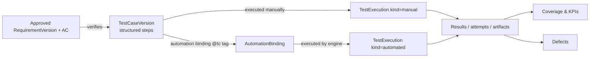

# 16 — Test Management Engine

> Status: **Planned** · Owner: QA Automation Architect · Modules: [M05](modules/M05-ai-test-studio.md), [M06](modules/M06-manual-testing-workspace.md) · Approval engine: §6

## 1. One quality model for manual and automated tests

A test case **always** has a structured specification, and that specification is the source of truth for intent. Automation is attached through bindings. A test case can be executed manually and automatically in parallel, for example during a transition period. Coverage counts both, with the dimensions `covered_manual`, `covered_automated`, and `covered_both`.

## 2. Gradual manual-to-automation path
| Stage | What changes | Enablers |
|---|---|---|
| 0. Manual only | Structured test cases, manual cycles | M05/M06 |
| 1. Candidates | QA marks stable, repetitive, high-value cases `candidate` (guided by "automation value score" checklist: run frequency, stability, steps count, data needs — shown as factors, not a black-box score) | M05 |
| 2. Generated drafts | M07 creates PRs; engineers review | M07 |
| 3. Dual run | Automated + manual execution for N cycles (policy, default 2) to build trust; results compared in cycle report | M06 + M08 |
| 4. Automated | Manual execution removed from regression cycle templates; manual exploratory continues | Cycle templates |
| 5. Maintained | Flaky monitoring, maintenance proposals, binding health | M08/M07 |

## 3. Versioning rules
- Drafts can be edited in place.
- Submitting a draft locks it for review.
- An approved version is immutable. Any edit creates version *n+1*.
- An execution references the exact version it ran.
- A requirement version change marks the linked test case `needs_review`, and the `verifies` link becomes `outdated` (BR-M05-5).
- A version diff shows step-level changes: added, removed, reordered, and changed text.

## 4. Coverage computation (deterministic)
For each approved requirement version R with AC set A:
- `ac_covered(a)` is true when there is at least one **approved** test case version T with an active link `verifies(T, R, a)`, or a requirement-level link if the project allows coverage without AC granularity.
- `req_coverage_status(R)`:
  - `uncovered` if no linked approved test exists
  - `partial` if some AC are uncovered
  - `covered_manual`, `covered_automated`, or `covered_both`, based on the automation status of the linked tests
  - `failing` if the latest final result of any linked test on the reference environment is failed
- The project-level KPIs (KPI-02 and KPI-03) are defined in [29](29-business-case-and-kpis.md).
- Coverage queries run on `traceability_links` plus `test_cases.automation_status` plus the latest-result materialized view `mv_latest_results(project_id, test_case_id, environment_id)`, which is refreshed on `run.finalized`.

## 5. Suites and selection
- **Static suites** keep an ordered list of test cases.
- **Dynamic suites** are a saved query over tags, type, priority, component, requirement, and automation status. The query is evaluated **at run creation**, and the resolved list is frozen into the run manifest.
- **Smoke and regression** are flags on suites. Several suites can carry them, and they are combined by union.
- **Impacted selection** ([19 WF-B](19-workflow-specifications.md)) uses the change-impact map from §7.

## 6. Approval Policy Engine (shared service, owned by M14)
**Policy document** (one per project, versioned):
```json
{
  "version": 4,
  "rules": [
    {"action": "requirement.approve", "approvers": {"roles": ["qa_lead","project_manager"], "count": 1},
     "separationOfDuties": true, "conditions": {"originIncludesInferred": {"approvers": {"roles": ["qa_lead"], "count": 1}}}},
    {"action": "testcase.approve", "approvers": {"roles": ["qa_lead","qc_reviewer"], "count": 1}, "separationOfDuties": true},
    {"action": "defect.external.create", "approvers": {"roles": ["qa_lead"], "count": 1},
     "conditions": {"severityIn": ["S1","S2"], "approvers": {"roles": ["qa_lead"], "count": 1}},
     "autoApprove": {"enabled": false}},
    {"action": "visual.baseline.approve", "approvers": {"roles": ["qa_lead"], "count": 1}},
    {"action": "run.production", "approvers": {"roles": ["qa_lead"], "count": 1}},
    {"action": "codegen.pr.open", "approvers": {"roles": [], "count": 0}},
    {"action": "ai.budget.increase", "approvers": {"roles": ["org_admin"], "count": 1}}
  ],
  "allowSelfApproval": false
}
```

**Engine semantics:**
1. `request(action, target, contentHash, requester)` returns an approval request, or `auto_approved` when the rule needs 0 approvers.
2. `decide(requestId, approver, decision)` checks:
   - the approver's role in the project
   - separation of duties
   - no duplicate decision by the same approver
   - that the `contentHash` still matches the target
3. When the approval count is met, the engine applies the action exactly once. It does this through a transition guarded by the expected state, plus an idempotency key `approval:{id}`.
4. Rejection returns the target to `draft` with a comment.
5. Expiry (default 7 days) sets the request to `expired`, and an escalation notification goes out (class O).

## 7. Change-impact map (test selection support)
- **Static mapping:** test files → app areas, through tags (`@area:checkout`) and optional `qualityos.config.json` path rules (`"src/checkout/**": ["@area:checkout"]`).
- **Learned mapping (optional, P10+):** co-change statistics between app paths and test failures. It is used as a hint only.
- **Requirement mapping:** commits that reference requirement or work-item IDs (e.g. `AB#123`) select the tests that verify those requirements.
- **Selection** is the union of these sources, plus always-on smoke tests. If the impact cannot be computed (no diff capability), selection falls back to smoke plus regression for the area tags, or to the full regression suite per policy.

## 8. Data-driven tests
Test data is a key/value table or a reference to a data set: CSV in the test repository or a QualityOS data table. Each parameter row becomes its own execution (`parameters` jsonb). Sensitive values are stored as secret references.
