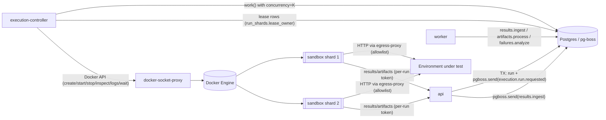

# 17 — Test Execution Engine

> Status: **Planned** · Owner: QA Automation Architect + Platform Engineer + Security Architect · Module: [M08](modules/M08-test-execution-center.md) · Decisions: [ADR-0006](adr/ADR-0006-pg-boss-queue.md), [ADR-0010](adr/ADR-0010-sandboxed-execution.md), [ADR-0018](adr/ADR-0018-test-engine-vs-execution-backend.md) · Facts: [36 §4–5](36-technical-validation.md)

## 1. Separation of concerns
| Concern | Component | Never does |
|---|---|---|
| Queue management (durable intent, retries, DLQ, scheduling) | **pg-boss** in Postgres | Run browsers |
| Run orchestration (claim, policy check, provisioning, monitoring, cancellation, reconciliation, finalization) | **execution-controller** (dedicated process, N instances) | Hold provider admin tokens; run test code itself |
| Test execution | **Ephemeral sandbox container** per shard | Reach host, DB, Docker, secrets beyond per-run tokens |
| Result ingestion & artifacts | **api** internal endpoints (per-run token) + **worker** jobs | — |
| Engine specifics (command, reporters, parsing) | **TestEngine adapter** (Playwright) | Know where it runs |
| Environment specifics (Docker, CI) | **ExecutionBackend adapter** | Know the engine's output format |

## 2. Components


## 3. Queue design (pg-boss)
| Queue | Policy | Key (`singletonKey`) | Retry | Expire / heartbeat | DLQ | Consumer |
|---|---|---|---|---|---|---|
| `execution.run.requested` | `standard` | — (concurrency enforced by controller per project) | retryLimit 2, backoff 30 s | expireInSeconds = run timeout + 600 (≤ 86 400); heartbeatSeconds 30 | `dlq.execution` | controller |
| `execution.run.cancel` | `standard` | runId | 5, 5 s | 120 s | `dlq.execution` | controller |
| `results.ingest` | `key_strict_fifo` | `run:{runId}` (order per run) | 5, backoff | 300 s | `dlq.results` | worker |
| `artifacts.process` | `standard` | — | 3 | 600 s | `dlq.results` | worker |
| `runs.finalize` | `singleton` | `run:{runId}` | 5 | 300 s | `dlq.execution` | worker |
| `failures.analyze` | `standard` | — | 3 | 600 s | `dlq.ai` | worker |
| `gate.evaluate` | `singleton` | `run:{runId}` | 3 | 120 s | `dlq.execution` | worker |
| `runs.reconcile` | `stately` | `controller:{instanceId}` | 0 (cron every 2 min) | 120 s | — | controller |
| `codegen.run` | `standard` | — | 1 | 3600 s; heartbeat 30 s | `dlq.codegen` | controller |
| `sync.poll` | `stately` | `binding:{id}:{stream}` | 3 | 900 s | `dlq.sync` | worker |

**At-least-once delivery handling.** Every consumer is idempotent:
- **controller `execution.run.requested`:**
  - It transitions `test_runs.state` from `queued` to `preparing` with an expected-state guard. If 0 rows are affected, another instance already claimed the run (or it was cancelled), so the job completes as a no-op.
  - Shard containers are named `qos-run-{runId}-shard-{i}-a{attempt}`. `create` with an existing name returns a conflict, and the controller then *attaches* to that container instead of creating a duplicate.
- **`results.ingest`:** each chunk carries `(runId, shard, seq, checksum)`, and the insert into `result_chunks` uses ON CONFLICT DO NOTHING.
- **`runs.finalize`:** a `singleton` queue plus the expected-state guard (`finalizing` to a terminal state).

## 4. Run lifecycle (sequence)
```mermaid
sequenceDiagram
  autonumber
  participant U as User / Automation API
  participant A as api
  participant Q as pg-boss
  participant C as execution-controller
  participant D as docker (via proxy)
  participant S as sandbox shard
  participant W as worker
  U->>A: POST /runs (Idempotency-Key)
  A->>A: authz + policy (env allowed for trigger, prod rules, concurrency hint)
  A->>A: resolve selection → bindings @ test-repo HEAD sha (or requested ref)
  A->>Q: TX { run_requests, test_runs(queued), run_manifest(draft), send(execution.run.requested) }
  A-->>U: 201 run(queued)
  C->>Q: fetch job (project concurrency check: running < maxParallel else re-defer job 30 s)
  C->>C: UPDATE run SET state=preparing WHERE state=queued
  C->>C: resolve image by lockfile Playwright version; pull if missing
  C->>A: mint per-run tokens (internal: clone-archive download, upload-only, ai-proxy if codegen)
  C->>C: preflight: env base URL reachable via egress proxy
  C->>D: create shard containers (labels qualityos.run_id, shard, attempt) + start
  C->>C: UPDATE run SET state=running; heartbeat job
  S->>A: GET archive (token) → extract → npm ci (registry mirror via proxy) → playwright test --shard i/N --reporter=junit,json,blob
  S->>A: POST result chunks + artifacts (token)
  A->>Q: send(results.ingest), send(artifacts.process)
  C->>D: wait(exit) / stream logs (sanitized → storage)
  C->>C: shard exit → run_shards update
  C->>Q: all shards done → send(runs.finalize)
  W->>W: finalize: derive statuses, flaky, manifest seal, state=passed|failed|errored
  W->>Q: send(gate.evaluate), send(failures.analyze)
  W->>A: outbox run.finalized → n8n notifications (class O)
```

## 5. Per-project execution policy
Stored in `project_settings.execution` (schema-versioned):
```json
{
  "maxParallelRuns": 2, "maxShardsPerRun": 4,
  "defaultRetries": 1, "maxRetries": 2,
  "testTimeoutMs": 60000, "runTimeoutMin": 60,
  "resources": {"cpus": 2, "memoryMb": 3072, "pids": 512, "shmMb": 1024, "tmpfsMb": 2048},
  "browsers": ["chromium"], "allowedBrowsers": ["chromium","firefox","webkit"],
  "environmentsByTrigger": {"manual": ["dev","staging"], "schedule": ["staging"], "ci": ["dev"], "pr": ["dev"], "retest": ["dev","staging"]},
  "productionPolicy": {"allowed": false, "smokeReadonlyOnly": true, "requiresApproval": true},
  "forkPullRequests": "deny",
  "flakyCountsAsPass": false, "quarantineExcludesFromGate": true,
  "interruptedRequeueMax": 1,
  "artifacts": {"video": "on-failure", "trace": "retain-on-failure", "screenshot": "only-on-failure", "har": "off"},
  "retention": {"videoDays": 30, "traceDays": 30, "screenshotDays": 90}
}
```
- The API checks the policy when a run is requested. The controller checks it again at claim time, because the policy may have changed in between.
- A request over the limits is either clamped (e.g. retries) with a warning, or rejected (e.g. a disallowed environment).

## 6. Sandbox specification
**Image:** `qos-sandbox:pw-<version>`, built from `mcr.microsoft.com/playwright:v<version>-noble`. It adds:
- `sandbox-entrypoint` (Node)
- `git`
- Arabic, CJK, and emoji fonts (`fonts-noto-core`, `fonts-noto-cjk`, `fonts-noto-color-emoji`)
- the CA bundle for the egress proxy, if TLS interception is ever used (default: no interception, CONNECT tunnelling only)

The controller keeps an allowlist of supported versions. If the lockfile requests an unsupported version, the run errors with `unsupported_engine_version` and the error suggests the nearest supported version.

**Container settings (Docker):**
| Setting | Value | Rationale |
|---|---|---|
| User | `pwuser` (non-root, uid 1000 in image) | Chromium sandbox enabled ([36 P1](36-technical-validation.md)) |
| seccomp | Playwright-provided `seccomp_profile.json` | Required for Chromium sandbox as non-root |
| Capabilities | `--cap-drop=ALL` | Least privilege |
| `no-new-privileges` | true | Block setuid escalation |
| Root FS | read-only | Tamper resistance |
| tmpfs | `/work` (sized by policy), `/tmp`, `/home/pwuser/.npm`. Nothing is shared with the host, and the dependency cache comes from the registry mirror (see below) | Writable scratch only |
| Shared memory | `--shm-size=1g` (not `--ipc=host`) | Keeps IPC namespace isolated (AS-07) |
| init | `--init` | Reap zombies |
| Limits | `--cpus`, `--memory` (no swap), `--pids-limit` | Resource isolation |
| Network | dedicated `qos-sandbox` bridge network with **no default route**; only reachable peers: `egress-proxy`, `api-internal` (sandbox listener) | Egress control |
| Env | `HTTP(S)_PROXY=http://egress-proxy:3128`, `NO_PROXY=api-internal`, run tokens, base URL, run config | — |
| Mounts | **none** from host | No host access |
| Labels | `qualityos.run_id`, `qualityos.shard`, `qualityos.attempt`, `qualityos.project_id` | Reconciliation |
| Restart policy | `no` | Ephemeral |
| Auto-remove | after controller collects logs and exit status | Cleanup |

**Dependency installation:** `npm ci` uses the project's lockfile through a **registry mirror/cache**, a `verdaccio` compose service in the `exec` profile (optional), or the public npm registry, which is then allowlisted. This speeds up warm runs without host mounts. Supply-chain note: untrusted lockfiles can install malicious packages. They are contained by the sandbox, and the npm `postinstall` scripts are allowed because Playwright tests often need them. The risk is accepted under the isolation boundary and recorded as R-07.

**Egress proxy:**
- Squid or tinyproxy with a **per-run ACL**. The controller writes an ACL file keyed by the run token (proxy auth username = run ID, password = proxy token), containing the environment `allowed_hosts`, the registry mirror, and the QualityOS internal endpoints.
- All other destinations are denied and logged as `egress_denied` with host, run, and time.
- Link-local and metadata IPs and private ranges are denied unless they are explicitly in `allowed_hosts`, because environments may be on a LAN.

**Credentials inside the sandbox:**
| Credential | Scope | TTL |
|---|---|---|
| Archive download token | GET this run's test-repo archive only | run timeout + 10 min |
| Upload token | POST results and artifacts for this run only | run timeout + 30 min |
| Environment test credentials | test accounts for the environment (from SecretStore), written into tmpfs as a `storageState` or env file | container lifetime |
| AI proxy token (codegen only) | gateway proxy for this job's budget | job timeout |
| Provider tokens (GitHub/Azure) | **never** | — |

**API sandbox listener.** The API exposes a separate listener for sandboxes: port 3002, network alias `api-internal`, reachable only on `qos-sandbox`. It serves **only** these routes: archive download, result/artifact chunk upload, baseline fetch, and the AI-gateway proxy (codegen jobs only). Every other route returns 404 on this listener. Each request must carry a per-run token whose audience matches the route.

**Docker socket proxy:**
- Exposes only `containers/create`, `start`, `stop`, `kill`, `wait`, `inspect`, `logs`, `delete`, plus `images/create` (pull) and `images/json`.
- Denies `exec`, `build`, `volumes`, `networks` (create), `swarm`, and `secrets`.
- An admission check in the controller rejects any container spec with binds, privileged mode, host network or PID or IPC, or added capabilities. That check is defence in depth, because the proxy cannot inspect request bodies.

## 7. Cancellation
1. `POST /runs/{key}:cancel` sets `cancel_requested=true`. If the run is `queued`, it transitions straight to `cancelled` and calls `pgboss.cancel()`. If it is `preparing` or `running`, the API sends an `execution.run.cancel` job.
2. The controller sends `SIGTERM` to each shard container. Playwright then stops gracefully and the reporters flush. After `graceMs` (default 20 s), the controller sends `SIGKILL`.
3. Partial results and artifacts already uploaded are kept. The run is finalized as `cancelled`, with counts for completed tests.
4. A cancel that races with finalization uses the expected-state guard, so whichever transition comes first wins, and both outcomes are consistent.

## 8. Failure recovery
| Failure | Detection | Recovery |
|---|---|---|
| Controller process crash | pg-boss heartbeat missed → job retried by another instance (or same after restart); `runs.reconcile` at start | Reconcile: list containers by label. **Running container found** → re-attach (logs/wait), refresh lease. **Exited container found** → collect exit status, request finalize. **No container, run `running`** → state `interrupted` → requeue if `attempt_no < interruptedRequeueMax` (new attempt, new manifest attempt), else `errored (infrastructure)` |
| Host reboot / laptop sleep | Containers gone or paused; leases expire | Same reconcile on start; sleep may pause containers → on resume, run timeout evaluated against wall-clock; exceeded → kill + `errored (timeout)` with note |
| Shard OOM / timeout | `inspect` OOMKilled / wall-clock | Attempt `errored` (reason), artifacts kept; no automatic rerun beyond policy retries |
| Environment down | Preflight or high rate of connection errors | `errored (environment)`; failure analysis groups → environment alert, no defects |
| Result upload partial | Missing chunk seq at finalize | Wait `ingestGraceSec` (60 s) → finalize with `incomplete` shard → run `errored` unless all expected tests reported |
| Postgres unavailable | Health check | Controller stops claiming; running containers continue; uploads buffered in-container with retry/backoff (entrypoint retries for up to 10 min) |
| Image pull failure | Docker error | 3 retries; then `errored (infrastructure)` |
| Disk pressure | Free space < threshold | Stop claiming; alert; retention job prioritised |

**Guarantee:** reconciliation plus the `automation.runs.reaper` (timeout + 5 min) mean no run stays `running` indefinitely (NFR-REL-04).

## 9. Results and artifacts
- The Playwright reporters configured by the engine adapter are `junit`, `json`, and `blob` (for sharded merge). The adapter parses JSON into canonical results: per test, its attempts, status, duration, error (message, stack top N frames), attachments, and annotations (tags and `@tc:` keys).
- **Attempts map one-to-one to Playwright retries.** `flaky` is derived from them.
- **Artifacts:** screenshots, videos, `trace.zip`, stdout/stderr logs, and optional HAR. They are uploaded through signed per-run URLs, then content-hashed and stored with a retention class.
- **Trace viewer:** the Playwright trace viewer static bundle (same version as the run) is served from `/trace-viewer/<version>/` with `?trace=<signed artifact URL>`, using a same-origin CSP.
- **Network evidence:** failed requests are extracted from the trace network log into `failure_analyses.signals.network`.

## 10. Visual regression execution
- At run start, the controller fetches the pinned baseline versions for the run's checkpoints into the sandbox (`/work/baselines`) through the internal API.
- The engine adapter configures `snapshotPathTemplate` to read baselines from there. Actual images and diffs are uploaded as artifacts. The QualityOS side records `visual_comparisons` (M09).
- **Determinism defaults:**
  - `animations: 'disabled'`, `caret: 'hide'`
  - fixed `timezoneId` and `locale` per matrix entry
  - `colorScheme` per theme
  - `reducedMotion: 'reduce'`
  - wait for `document.fonts.ready`
  - fixed viewport sizes
  - a mocked clock when the project enables it
- **Baselines are never written by runs.** New checkpoints produce *candidate* baselines (M09-FR-10).

## 11. Parallel and distributed execution (future-ready)
- **Today:** the local Docker backend runs `maxParallelRuns × maxShardsPerRun` within host limits (pilot default 2 × 2).
- **Tomorrow:**
  - The execution controller becomes a **runner agent** deployed on N hosts. Each agent pulls `execution.run.requested` jobs from Postgres over a secured DB connection, or from an HTTP job-lease API on the core over mTLS (preferred for network segmentation).
  - Agents advertise capacity and labels (os, browsers, GPU, network zone) and claim work whose labels match.
  - The `ExecutionBackend` port and the RunSpec don't change. Only lease ownership and capacity accounting move to `runner_agents` and `runner_leases` tables.
- **Kubernetes Jobs backend:** an option when company IT runs K8s (OD-12). Each shard becomes a Job with the same security context and a NetworkPolicy instead of the egress proxy.

## 12. CI-delegated backend
- **Trigger mode:** QualityOS calls `ci.pipeline.trigger` with variables (`QOS_RUN_ID`, `QOS_UPLOAD_TOKEN`, `QOS_API_URL`, selection file URL). The pipeline runs Playwright with the QualityOS reporter package and uploads results to `/automation/v1/runs/{id}/results`.
- **Ingest-only mode:** the pipeline calls `POST /automation/v1/runs` (creates a run with trigger `ci`), then uploads its results.
- **Isolation** is then the CI system's responsibility, which is documented as a trust-boundary change ([21 §9](21-security-architecture.md)).
- **Contract:** results are the same canonical JSON plus artifact manifest, so M08-AC-10 holds for every backend.
