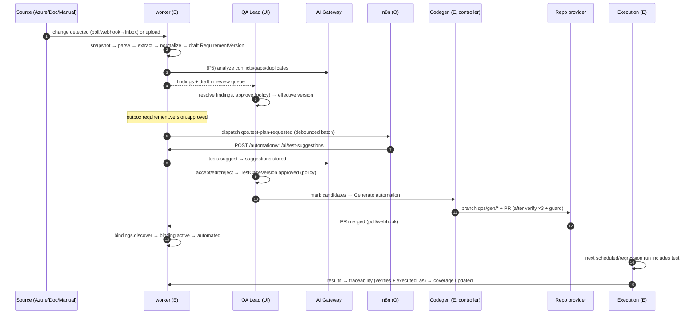
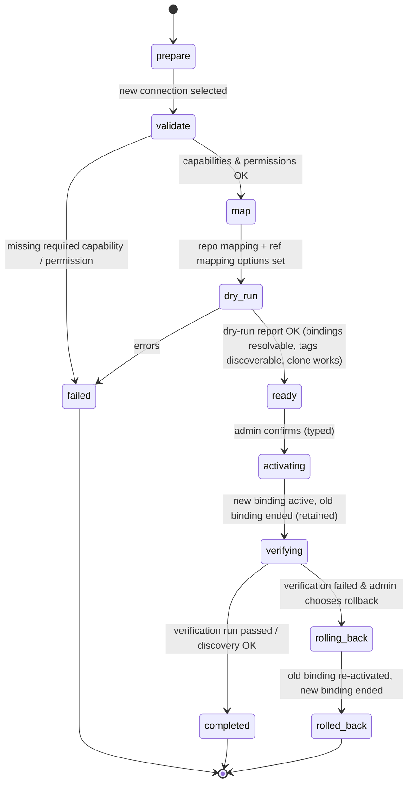

# 19 — Workflow Specifications (End-to-End)

> Status: **Planned** · Owner: Principal Architect + QA Lead · Orchestration rules: [18](18-n8n-orchestration.md) · Domain states: [09 §3](09-domain-model.md)

## 1. Event contract
**Envelope** (stored in `outbox_events` and dispatched in minimal form):
| Field | Type | Notes |
|---|---|---|
| `eventId` | UUIDv7 | Dedupe key for every consumer |
| `type` | string | `aggregate.fact`, from the catalog in [09 §4](09-domain-model.md) |
| `specVersion` | "1.0" | Envelope version |
| `occurredAt` | timestamp | Time of the TX commit |
| `projectKey` / `projectId` | | null for org-level events |
| `subject` | `{type, id, key}` | Aggregate reference |
| `data` | object | Event-specific, schema in `@qos/contracts/events/<type>.ts`. **Never** contains secrets, and contains only minimal content |
| `correlationId` | string | Propagated from the request or job |
| `causationId` | string? | The event or command that caused this one |
| `actor` | `{type: user/service/system, id}` | |

**Versioning:** additive changes keep the type. Breaking changes create `type.v2`, and both are emitted during migration. Consumers must ignore unknown fields.

Each workflow below lists, in order: its trigger, its steps (owner and work class), its state changes, the failure branches, and its acceptance criteria.

---

## WF-A — Requirement to Test

| Step | Owner / class | State change |
|---|---|---|
| Ingest | worker / E | `source_snapshots` + `extracted_items` |
| Normalize | worker / E | RequirementVersion `draft` |
| Analyze | worker + AI / E | `requirement_findings(open)` |
| Approve | user + policy engine | version `approved`, previous `superseded` |
| Request suggestions | n8n / O, or user directly | `operations` + `ai_suggestions(pending)` |
| Accept tests | user + policy | TestCaseVersion `approved`, `verifies` links |
| Generate code | controller / E | `code_generation_jobs` → PR ExternalRef |
| Merge | human in Git | — |
| Bind | worker / E | `automation_bindings(active)`, test case `automated` |
| Execute & trace | controller + worker / E | results → coverage |

**Failure branches:**
- *Parse fails* → snapshot `parse_failed` and the user is notified. A manual-entry path is offered.
- *AI unavailable* → deterministic extraction only. Suggestions are disabled and manual authoring is used.
- *Approval rejected* → back to draft with a comment.
- *Codegen guard blocked or compile failure* → job failed, no PR, and the test case stays `candidate`.
- *PR closed unmerged* → job `abandoned`.
- *Binding not found after merge* (no tag) → `automation_broken` warning.

**Acceptance:** M04-AC-01/03/09, M05-AC-01, M07-AC-01/04, M08-AC-01.

---

## WF-B — Code Change to Automated QA
```mermaid
sequenceDiagram
  autonumber
  participant G as Repo/CI provider
  participant API as api (webhooks)
  participant W as worker (E)
  participant N as n8n (O-F)
  participant C as controller (E)
  participant Q as Gate (E)
  G-->>API: push/PR webhook (verified → inbox) or poll detects commit
  W->>W: inbox.process → re-fetch commit/PR → outbox repo.pr.opened / repo.push.detected
  W->>N: dispatch qos.pr-opened
  N->>API: POST /automation/v1/rules/{prRule}/fire {slotKey: pr:{prId}:{headSha}}
  API->>W: change impact: diff paths → area tags; referenced work items → requirements → tests; ∪ smoke
  API->>C: run (trigger=pr, selection=impacted, env per policy)
  C->>C: sandboxed run → results
  W->>Q: gate.evaluate → pass/warn/fail
  Q->>G: (optional) ci.status.report / PR comment via core action (policy)
  W->>N: dispatch run.finalized / gate.evaluated → notify team
```
- **Webhook vs polling:** polling commits and PRs (every 2 min) produces the same inbox entries, keyed by dedupe key `commit:{sha}` or `pr:{id}:{headSha}`. Whichever source arrives first creates the work, and the duplicate becomes a no-op.
- **Fork PRs:** denied by policy (BR-M08-5). A notification explains why.
- **Fallback:** if n8n is down, the core fallback fires the PR rule after grace, using the same slot key `pr:{prId}:{headSha}`.
- **No impact computable:** smoke plus area regression, or full regression, per policy ([16 §7](16-test-management-engine.md)).

**Acceptance:** M08-AC-04, M11-AC-01/02, plus the WF-B E2E in demo mode (mock GitHub PR event → impacted run → gate).

---

## WF-C — Failure to Bug Report
```mermaid
sequenceDiagram
  autonumber
  participant C as controller
  participant W as worker (E)
  participant AI as AI Gateway
  participant UI as QA (approver)
  participant POL as Policy engine
  participant IT as IssueTracker adapter
  C->>W: run.finalized (attempts incl. retries recorded)
  W->>W: failures.analyze: deterministic signals per failed final result
  W->>AI: failures.classify (evidence digest) → classification/confidence/rationale
  W->>W: cluster by signature (+ cluster_merge)
  W->>W: env/infra clusters → health alert (no defect); test_defect → M07 fix proposal suggestion
  W->>W: product_defect clusters → duplicate candidates (signature+vector+links)
  W->>AI: defects.duplicate_judge (top-3) ; defects.draft
  W-->>UI: defect draft + duplicates + evidence
  UI->>POL: approve (or mark duplicate / reject)
  POL-->>W: approved (policy satisfied)
  W->>W: TX: defect(open) + idempotency key defect:{id}:create + outbox
  W->>IT: createIssue(marker, mapped fields) [defects.sync.push job]
  alt timeout/unknown
    W->>IT: searchByMarker → found? store ref : retry create
  end
  W->>W: ExternalRef stored; external_sync_state=synced
  W->>W: issue tracker sync.poll → state mapping → lifecycle updates
```
**Retry/reproduction policy (before classification):**
- Automated tests are retried in-run per policy (default 1), and all attempts are recorded.
- If `reproduce_on_fail` is enabled for the project, a **reproduction run** of failing tests only (1 extra attempt, same environment and build) is queued after finalize. Its result feeds the flaky signal, and the original run is never modified.

**Failure branches:**
- AI unavailable → deterministic classification, and the draft is built from a template.
- Tracker down → defect `open` with `sync pending`, retried, then dead-lettered with "Sync failed" visible.
- Required external field missing → push fails with the field name, and the mapping UI points to it.
- Approval expired → escalation.

**Acceptance:** M10-AC-01…05.

---

## WF-D — Bug Fix Verification
```mermaid
sequenceDiagram
  autonumber
  participant G as Repo / Issue tracker
  participant W as worker (E)
  participant N as n8n (O-F)
  participant C as controller
  participant UI as QA
  G-->>W: commit "Fixes SHOP-D-77" / "AB#1234" on configured branch, or external state → Resolved (sync)
  W->>W: fix.detect → defect fix_candidate (+fixed_by link to commit ExternalRef)
  W->>N: dispatch qos.fix-detected-retest
  N->>W: POST /automation/v1/defects/SHOP-D-77/retest (Idempotency-Key defect:{id}:fix:{ref}:retest)
  W->>C: run(trigger=retest, selection=bindings linked to defect, env per policy, after deployment containing fix if configured)
  W->>UI: manual retest execution proposed for linked manual-only tests
  C->>W: results
  W->>W: verification: passed on build ≥ fix → verified ; failed → failed_verification ; flaky → inconclusive
  W->>G: (policy) comment verification evidence ; transition external state only if allow_external_close
```
- **"Build ≥ fix" determination:** the run manifest's `build_label` or deployed SHA must contain the fix commit. This uses the CI deployment event SHA, or the user confirms it for manual retests. If it cannot be determined, the result is `inconclusive`, with a prompt to confirm.
- **Waiting for deployment (optional):** the rule parameter `wait_for_deployment=true` makes n8n wait for a matching `ci.deployment.completed` event (up to 24 h) before calling retest. The fallback creates the retest immediately, flagged `may_predate_deploy`.

**Acceptance:** M10-AC-06/07, M06-AC-06.

---

## WF-E — Document Requirements Change
```mermaid
flowchart TB
  U[Upload v2 of document series] --> V[Validate + snapshot (checksum differs)]
  V --> P[Parse → extract]
  P --> M[Match to v1 items: IDs → locator+similarity]
  M --> D[Diff: added / changed / removed (requirement + AC level)]
  D --> DR[New draft versions for changed; new candidates for added; source_removed for removed]
  DR --> I[Impact: affected test case versions, bindings, open defects, active cycles]
  I --> S[AI tests.suggest_updates (optional)]
  S --> R[Human review: approve requirement versions + accept test updates]
  R --> T[Traceability: verifies links to new versions; outdated links closed]
```
**Rules:**
- Nothing approved changes until a human approves it (BR-M04-4).
- Tests linked to changed requirements are `needs_review` until a decision is made.
- Possible matches in the 0.80–0.92 similarity band need confirmation.

**Failure branches:** if parsing degrades (for example, v2 is scanned but v1 was digital), the review shows a quality warning and asks for manual confirmation of the diff.

**Acceptance:** M04-AC-04, M05-AC-04.

---

## WF-F — Provider Switching (example: GitHub → GitLab for a project)

**Steps:**
1. **Prepare.** Choose the role (`repository`, `test_repository`, `issue_tracker`, …) and the target connection.
2. **Validate.** Run a connection test and check effective capabilities against the role's required capabilities. Check access to the specific target resource (repository or project) and branch protection status.
3. **Map.**
   - For repositories: choose the target repository. For mirrored history, enable SHA continuity, so commits map 1:1 by SHA; `ref_mappings` records the branch name mapping.
   - For trackers: choose the handling of open defects (`legacy_sync` until closed / stop / recreate with cross-reference).
   - Status and field mappings for the new tracker must pass lint.
4. **Dry run** (no side effects):
   - Resolve bindings at the new HEAD: tag discovery count compared with the old one.
   - Clone or archive access check.
   - Webhook setup instructions.
   - The report shows the impact: X bindings found, Y missing, Z open defects affected.
5. **Activate** (single TX):
   - End the old binding (`ended_at`) and create the new binding.
   - Record the audit entry and emit `project.binding.changed`.
   - Pause automation rules using the role for the duration of verification, which is the default.
6. **Verify.** Run `bindings.discover` and an optional smoke run through the new provider (codegen dry-run for the test repo). For trackers: create an issue in sandbox mode only if the provider supports it; otherwise run a metadata check only.
7. **Complete.** Resume the rules. The old connection can be retired later (M03-FR-12).

**Historical integrity:**
- Old ExternalRefs are untouched.
- Historical runs keep `run_manifests.test_repo_ref/sha` and their `binding_snapshot`.
- Old PR links render from snapshots. Audit history is unchanged.

**Rollback:** possible until the first write through the new binding (new PR, new issue). After that, a "reverse switch" is a new forward switch, and no data is deleted.

**Failure scenarios:**
- Permission errors at validate are surfaced precisely.
- A tag discovery mismatch at dry-run means the test repository content differs. The switch is blocked unless forced with a reason.
- Webhook registration failure is non-blocking, because polling covers it.

**Acceptance:** M02-AC-04, M03-AC-05, M10-AC-09, plus the WF-F E2E with mock GitHub → mock GitLab.

---

## WF-G — Scheduled regression with orchestrator outage (resilience reference)
1. Rule "Nightly regression 02:00 Africa/Cairo" (O-F, grace 5 min).
2. n8n is healthy, so at 02:00 it calls `fire(slot=2026-11-10T00:00Z)` (02:00 local = 00:00Z). The firing is created and the run is created.
3. n8n is down, so health is `down` since 01:40. At 02:05 the fallback finds the slot unclaimed and fires it with `fired_by=core_fallback`, and an in-app notice is created. When n8n recovers at 02:30, its catch-up check calls `fire` for the same slot and gets `alreadyFired`.
4. If the laptop sleeps 23:00–08:00 with `latest_only`, then at wake (08:00) the fallback scheduler evaluates missed slots within the catch-up window and fires 02:00 once.

**Acceptance:** M11-AC-01/02/05.

---

## WF-H — Manual test cycle (reference)
Cycle created → executions assigned → step runner → failure → defect draft (WF-C from the approval step onward) → retest when the defect reaches `fix_candidate` (WF-D) → cycle close with exit criteria → cycle report (M12).
**Acceptance:** M06-AC-01…07.
