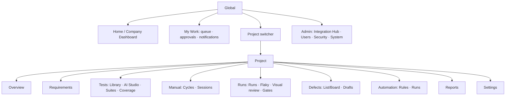

# 20 — UI/UX Architecture

> Status: **Planned** (no UI built) · Owner: UI/UX Product Designer + Frontend · Stack: [ADR-0016](adr/ADR-0016-nextjs-ui-only.md), [08](08-technology-decisions.md)

## 1. Design intent
QualityOS should feel like a **calm, precise instrument for professionals**: dense with information, fast, and legible, closer to Linear, Vercel, or Grafana than to an admin template.

Design principles:
1. **Status is the primary visual language.** Pass, fail, flaky, blocked, pending, AI-suggested, and stale each get a consistent color, icon, and label. Color is never the only signal.
2. **Density with hierarchy.** There are three density modes: comfortable, compact (default for tables), and dense. The strongest visual weight goes to what needs a decision.
3. **Evidence one click away.** Every number, AI output, and external item links to its source.
4. **Keyboard-first.** A command palette (`Ctrl/⌘+K`), list navigation (J/K), contextual shortcuts, and visible shortcut hints.
5. **Glass, sparingly.** Translucent surfaces are used only for overlays (command palette, popovers, toasts, side-sheet headers), with a solid fallback when `prefers-reduced-transparency` is set or contrast fails. Data tables and reading surfaces stay opaque.
6. **Calm motion.** 150–200 ms ease-out transitions, no decorative animation, and `prefers-reduced-motion` is respected.
7. **Bidirectional by construction.** Layouts use CSS logical properties (`margin-inline-start`, `inset-inline-end`) from day one, and icons with direction mirror in RTL.

## 2. Information architecture


**Navigation layout:**
- **Left sidebar** (collapsible to icons, 240 px or 64 px):
  - project switcher at top
  - project sections
  - divider
  - global items (Home, My Work)
  - admin, which is visible only to admins
- **Top bar:**
  - breadcrumbs
  - command palette trigger
  - global search
  - orchestrator/health indicator (a dot that turns amber or red with a popover)
  - notifications
  - theme toggle
  - user menu
- **Content area:** a list or detail split view. Details open as a right **side sheet** (resizable) for quick triage, or as a full page for deep work.

## 3. Design tokens (initial)
Tokens are defined as CSS variables under `@qos/ui/tokens`, with light and dark values, and mapped to Tailwind theme keys.

| Token group | Tokens (examples) | Light | Dark |
|---|---|---|---|
| Neutral surfaces | `--surface-0` (app bg), `--surface-1` (cards), `--surface-2` (raised), `--surface-glass` | #F7F8FA, #FFFFFF, #FFFFFF, rgba(255,255,255,0.72) | #0B0D12, #12151C, #181C25, rgba(24,28,37,0.72) |
| Text | `--text-1`, `--text-2`, `--text-3` | #0F1720, #3B4654, #6B7686 | #E8ECF2, #B4BDCB, #808A99 |
| Border | `--border-1`, `--border-strong` | #E3E7ED, #CBD2DB | #232836, #333A4B |
| Brand | `--brand-600` (primary actions), `--brand-50` | Indigo-teal family: #3E5BDB / #EEF2FF | #7C93FF / #1A2140 |
| Status | `--st-pass`, `--st-fail`, `--st-flaky`, `--st-blocked`, `--st-skipped`, `--st-running`, `--st-ai`, `--st-stale` | green #1F9D55, red #D64545, amber #C98A0B, purple #7E57C2, gray #8A94A6, blue #2F80ED, violet-gradient accent for AI #6D5DFC, slate #64748B | lifted for dark contrast |
| Severity | `--sev-1…4` | red, orange, amber, slate | — |
| Radius | `--r-sm 6px`, `--r-md 10px`, `--r-lg 14px` | | |
| Elevation | `--shadow-1`, `--shadow-2`, `--shadow-overlay` | subtle, low-spread | dark mode uses borders + faint glow instead of shadows |
| Spacing | 4 px base: 1=4, 2=8, 3=12, 4=16, 6=24, 8=32 | | |
| Typography | UI: **Inter** (Latin) + **IBM Plex Sans Arabic** (Arabic); Mono: **JetBrains Mono**; scale 12/13/14/16/20/24/30; tabular numbers for metrics | | |
| Motion | `--dur-fast 120ms`, `--dur-base 180ms`, `--ease-out cubic-bezier(.2,.8,.2,1)` | | |

Every text/background pair is checked against WCAG 2.2 AA in CI with a token contrast test. Status colors always come with an icon and a text label.

## 4. Screen inventory
| ID | Screen | Module | Primary user | Notes |
|---|---|---|---|---|
| S-ONB-01 | First-run wizard (admin, org, demo vs real) | M14/M02 | Admin | |
| S-DSH-01/02 | Company dashboard, comparison | M01 | All | |
| S-MY-01 | My Work (queue, approvals, mentions) | M06/M14 | All | Default landing for QA engineers |
| S-PRJ-01…05 | Project overview, wizard, settings, environment editor, binding change | M02 | Lead/Admin | |
| S-INT-01…07 | Integration hub, catalog, setup, detail, mapping, switch assistant, retire | M03 | Admin | |
| S-REQ-01…07 | Requirements list, detail, extraction review, diff, findings, sources, upload | M04 | Lead/QA | Extraction review = split view |
| S-TST-01…06 | Library, editor, AI studio, review queue, coverage heatmap, suite builder | M05 | QA | |
| S-MAN-01…06 | Queue, step runner, cycle planner, cycle dashboard, exploratory session, execution detail | M06 | QA | Step runner = focus mode |
| S-GEN-01…04 | Codegen request, jobs, bindings, repo onboarding | M07 | Automation Eng | |
| S-EXE-01…07 | Runs, new run, live run, run viewer + failure analysis, result detail, policies & gates, flaky board | M08 | QA/Dev | Trace viewer embedded |
| S-VIS-01…04 | Visual review queue, checkpoint, diff viewer, settings | M09 | QA | |
| S-DEF-01…04 | Defects list/board, detail, draft review, verification | M10 | QA/Dev | |
| S-AUT-01…05 | Rules, rule editor, automation runs, orchestrator & DLQ, templates | M11 | Lead/Admin | |
| S-RPT-01…06 | Reports home, viewer, builder, exec summary, cost, AI quality | M12 | Lead/PM/Exec | |
| S-ADM-01…05 | Users, user detail, service accounts, roles matrix, access review | M13 | Admin | |
| S-SEC-01…08 | Audit, approval policies, approvals inbox, AI budgets, retention, backups, health, system settings | M14 | Admin | |
| S-SET-01 | Personal settings | M14 | All | |

## 5. Key layouts (wireframe descriptions)
### Company dashboard (S-DSH-01)
```
┌ Sidebar ┐┌ Top bar ───────────────────────────────────────────────┐
│         ││ Home                         ⌘K  ● n8n  🔔  ◐  (avatar) │
│         │├────────────────────────────────────────────────────────┤
│         ││ [Projects 12] [Exec 7d 4,812] [1st-pass 93.1%] [Flaky 2.4%] [Open S1/S2 5] [Req cov 71%]  ← tiles w/ ⓘ │
│         ││ ┌ Projects table (sortable, density) ───────────┐ ┌ My work ┐│
│         ││ │ Key Name  Risk  ReqCov  LastReg  S1/S2 Flaky … │ │ 6 tests  ││
│         ││ └───────────────────────────────────────────────┘ │ 3 approv ││
│         ││ ┌ Pass rate trend ┐┌ Defects in/out ┐              ├ Activity ┤│
│         ││ └─────────────────┘└────────────────┘              │ …        ││
└─────────┘└────────────────────────────────────────────────────────┘
```

### Extraction review (S-REQ-03)
The left pane is the source viewer: a PDF page or DOCX HTML, with highlighted blocks. The right pane holds candidate cards in source order. Each card shows a confidence chip, an origin badge, the locator, and Accept / Edit / Merge / Split / Reject buttons. A sticky footer shows counts and a bulk accept for items with confidence ≥ threshold, and **excludes inferred items**. Keyboard: J/K, A, E, M, X.

### Step runner (S-MAN-02)
Focus mode with a minimal sidebar. The header shows the test key and title, the version, the environment and build, and a timer. The left column lists steps with status chips. The right column shows the current step's action, data, and expected result, an actual-result input, and an evidence dropzone. The footer status bar shows `P F B S` hints, Next, and Complete. When a step fails, a "Create defect" call to action appears. An offline indicator shows when the connection is lost.

### Run viewer & failure analysis (S-EXE-04)
The summary header has counts, the gate badge, and a manifest link. The tabs are Results, Failures, Network, Artifacts, Manifest, and Gate. The Failures tab shows clusters. Each cluster shows the classification (with an AI badge), confidence, rationale, evidence chips (trace step, console, network), duplicate candidates, and actions: create a draft, mark it as environment, or send it to maintenance.

### Defect draft review (S-DEF-03)
This is a two-pane screen:
- **Left pane:** an editable report with an AI badge on generated sections and a severity rationale.
- **Right pane:** evidence (trace thumbnails, screenshots, logs) and duplicate candidates shown side by side with similarity reasons.
- **Footer:** the approval action, labelled with the policy requirement (e.g. "Requires 1 QA Lead approval").

## 6. Component inventory (`@qos/ui`)
- **Primitives (shadcn/Radix):** Button, IconButton, Input, Textarea, Select, Combobox, Checkbox, Radio, Switch, Tabs, Dialog, Sheet, Popover, Tooltip, DropdownMenu, ContextMenu, Toast, Badge, Avatar, Separator, ScrollArea, Skeleton, Progress, Command palette.
- **Data:** DataTable (TanStack: virtualization, column pinning, resizing, saved views, bulk bar, density), TreeTable (requirements and suites), KeyValueList, Timeline, DiffViewer (text), ImageDiffViewer (side-by-side, slider, heatmap), CodeBlock, LogViewer (virtualized, ANSI, search), TraceViewerFrame, JsonViewer.
- **Domain:** StatusChip, SeverityBadge, PriorityBadge, AIBadge (with popover: task, model, prompt version, cost), ProvenanceChip (source plus locator), ExternalRefChip (provider icon, key, sync state, stale), ConfidenceMeter (bar plus number, never alone), CoverageBar, GateBadge, RiskIndicator (level plus factors), MetricTile (value, delta, provenance tag, info popover), EvidenceGallery, StepGrid (editor and runner variants), ApprovalBanner, OrchestratorStatusDot, EmptyState, ErrorState, PermissionState.
- **Charts:** Sparkline, TrendLine, StackedBar, Heatmap. All are accessible: data table fallback and keyboard focus on points.

## 7. Interaction specifications
| Interaction | Specification |
|---|---|
| Command palette | `Ctrl/⌘+K`; actions + navigation + entity search (keys, titles, external IDs); recent items; scoped to project when inside one |
| List navigation | J/K move, Enter open, X select, Shift+X range, `/` focus filter |
| Optimistic updates | For status changes (step results, triage actions) with rollback toast on failure |
| Long operations | Inline progress (operation SSE), cancel where supported, toast on completion with link |
| Destructive actions | Confirmation dialog stating consequences; typed confirmation for delete/retire/switch provider |
| AI outputs | Always labelled; "Why?" popover shows rationale/evidence; accept/reject inline; never auto-applied |
| External items | Chip with provider icon; hover shows last sync, stale warning; click opens provider in new tab |
| Forms | Inline validation from Zod schemas; server errors mapped to fields; autosave drafts where safe |
| Real-time | SSE for runs, operations, notifications; graceful reconnection with backoff |

## 8. States
Every view designs all of these:
- **Empty:** explains the next step, with a primary action, e.g. "No requirements yet: connect Azure Boards, upload a document, or add manually", plus "Load demo data" when in demo mode.
- **Loading:** skeletons that match the layout. Spinners are used only for actions under 1 s.
- **Error:** a human message, an error ID (correlation ID), a retry, and a link to the health page if the error is systemic.
- **Partial:** shown per-region, e.g. "Coverage unavailable: analytics refresh pending".
- **Permission:** "You don't have access", naming the required role. Hidden actions vs disabled with a tooltip: actions are disabled when the user knows the object exists, and hidden otherwise.
- **Stale or offline:** a banner with a timestamp.
- **Orchestrator degraded:** a top-bar amber dot and a banner in Automation pages: "n8n unavailable since 01:40. Scheduled runs use fallback. Notifications are queued (12)."

## 9. Localization and RTL
- **i18n:** next-intl with ICU messages. Message catalogs live per module namespace. The API returns error codes and parameters, never localized prose.
- **Locales:** `en` (P1) and `ar` (P10–P11). Dates use `Intl.DateTimeFormat` in the user's timezone. Numbers are Latin by default, with Arabic-Indic digits as a user preference.
- **Direction:** `<html dir>` follows the locale. Mixed-direction content uses `dir="auto"` on user-generated text blocks. Code, logs, and URLs are always LTR, isolated with `<bdi>`.
- **Layout:** logical properties only. A lint rule (stylelint or a Tailwind plugin) bans physical `ml-`/`mr-`/`left-`/`right-` classes in favor of `ms-`/`me-`/`start-`/`end-`. Icons with direction (arrows, chevrons) mirror via a `rtl:` variant.
- **Testing:** visual tests for core screens in `ar`/RTL and `en`/LTR, in light and dark (P10).

## 10. Accessibility
- WCAG 2.2 AA (NFR-UX-01).
- Focus management in dialogs and sheets, with focus returned on close. Skip links. Landmarks.
- DataTable uses an ARIA grid pattern with row and column headers, announces sort and selection, and moves focus by keyboard.
- Charts have table fallbacks, and status is never conveyed by color alone.
- axe-core checks run in Playwright E2E on every core screen, and CI fails on serious or critical violations.

## 11. Onboarding
- The first-run wizard (S-ONB-01) offers demo mode, which loads a seeded project (requirements from mock Azure plus an English and Arabic PDF, test cases, runs with failures, and defects).
- A guided checklist on the project overview walks through: connect source, approve 5 requirements, generate tests, run a cycle, and connect a tracker. It is dismissible.
- Contextual empty states replace tours, so there are no modal walkthroughs.

## 12. Frontend architecture notes
- Next.js App Router. Route groups are `(app)/[projectKey]/…` and `(admin)/…`. Server Components fetch the initial data through the typed API client. Client components use TanStack Query, with query keys keyed by `projectKey`.
- Auth: the BFF holds the session cookie, and API calls from Server Components forward the session. There are no tokens in browser storage.
- Feature gating uses `/api/v1/me/permissions?projectKey=` (cached), so the UI hides or disables actions. The server always enforces permissions regardless.
- Storybook covers `@qos/ui` and domain components, with visual tests via Playwright screenshots in both themes and both directions.
