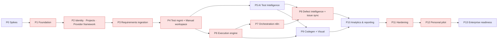

# 25 — Implementation Roadmap

> Status: **Planned**. No phase has started, and implementation needs explicit owner approval of this package. · Owner: Product Manager + Principal Architect · Tasks: [26](26-task-breakdown.md) · Acceptance: [32](32-acceptance-criteria-matrix.md)

## 1. Phase structure
The brief proposed 15 phases. We restructured them by dependency analysis:
- **Manual QA value comes early (P4).** Most of the target organization's QA work is manual, so this is the first thing that is useful to them.
- **AI arrives after the data model is proven.**
- **Orchestration (P7) follows execution (P6)**, because the most important workflows trigger runs.
- **Team permissions are not a late phase.** RBAC enforcement is part of P2 from the start, and P11 only adds advanced features.
- **Hardening (P11) comes before the pilot (P12).**

**Critical path:** P0 → P1 → P2 → P3 → P4 → P6 → P7 → P8 → P10 → P11 → P12.
- P5 can run in parallel with P6.
- P9 can run in parallel with P8.
- P10 depends on data from P8 and P9, though its KPI foundations can start early.

**Indicative effort** (one experienced developer with Claude Code assistance; to be re-estimated after P0):
| Phase | Effort |
|---|---|
| P0 | 1 week |
| P1 | 1.5 weeks |
| P2 | 3 weeks |
| P3 | 3 weeks |
| P4 | 3 weeks |
| P5 | 2.5 weeks |
| P6 | 3.5 weeks |
| P7 | 2 weeks |
| P8 | 3 weeks |
| P9 | 3.5 weeks |
| P10 | 2 weeks |
| P11 | 2.5 weeks |
| P12 | 4–6 weeks of calendar time |
| P13 | 4+ weeks |

These are planning estimates, not commitments (AS-01).

## 2. Phases
Each phase lists objectives, scope, features, dependencies, technical tasks, file/module ownership, acceptance criteria, tests required, Definition of Done, risks, validation evidence, and deliverables. Task IDs refer to [26](26-task-breakdown.md).

---

### P0 — Discovery spikes and version pinning
- **Objectives:** remove the riskiest unknowns and pin versions.
- **Scope:** spikes T-P0-01…06 ([36 §9](36-technical-validation.md)). No product code.
- **Dependencies:** owner approval of this plan.
- **Ownership:** `spikes/` (throwaway; not merged into the product), `docs/planning/36` updates.
- **Acceptance:**
  - Parser chosen against the [14 §7](14-requirements-engine.md) metrics.
  - Sandbox stable for 50 runs on the pilot machine.
  - n8n CE behavior confirmed: CLI import, activation, health, HMAC in a Code node, and whether the API is available.
  - pg-boss and Drizzle transactional send proven.
  - AI structured output measured (done on Gemini, ADR-0019).
  - Versions pinned.
- **Tests:** spike scripts with recorded results.
- **DoD:** OD-02 and OD-09 decided. 36 updated. Risks R-01, R-06, and R-07 re-rated.
- **Risks:** if the Windows/WSL2 egress proxy is problematic, the fallback is a per-run Docker network with iptables rules set by an admin helper. That fallback is documented, and choosing it needs an ADR.
- **Evidence:** a spike report with measurements.
- **Deliverables:** an updated planning package, and pinned versions in 36.

### P1 — Monorepo and core foundation
- **Objectives:** a runnable skeleton with every cross-cutting mechanism in place.
- **Scope:**
  - monorepo and tooling
  - Compose `core` profile
  - config, logging, tracing hooks, health checks
  - Postgres with migrations and the pg-boss bootstrap
  - outbox and inbox tables, the `operations` API, the idempotency middleware
  - the localfs storage adapter
  - web shell (layout, tokens, theme, i18n scaffolding, RTL lint)
  - CI pipeline with fitness functions
- **Features:** none user-facing beyond the shell and the health page.
- **Dependencies:** P0.
- **Tasks:** T-P1-01…18.
- **Ownership:** `apps/*`, `packages/{contracts,kernel-domain,ports,config,ui}`, `infra/compose`, `.github/workflows` (CI).
- **Acceptance:**
  - `docker compose --profile core up` boots, and `/readyz` reports green for api, worker, and web.
  - A sample command writes domain row, audit, outbox, and job **atomically**, and a forced rollback leaves none of them (integration test).
  - The idempotency middleware returns the cached response for a repeated key.
  - The dependency-cruiser and provider-literal lint rules run in CI.
  - The UI shell renders in light, dark, LTR, and RTL.
- **Tests:** unit and integration (Testcontainers), lint and fitness functions, an E2E smoke of the shell.
- **DoD:** CI green. README for developers. ADRs unchanged or superseded properly.
- **Risks:** tooling churn. Mitigation: pinned versions.
- **Evidence:** CI run, screenshot of the health page.
- **Deliverables:** a running skeleton.

### P2 — Identity, projects, provider framework, governance base
- **Objectives:** a secure multi-project foundation with a working provider framework and demo mode.
- **Scope:**
  - **M13 base:** auth, MFA, invitations, RBAC guard, memberships, service tokens.
  - **M02:** projects, environments, bindings, settings, wizard.
  - **M03 framework:** registry, connections, capability checks, ExternalRef, inbox and webhook verification, sync framework, mapping editor, health, contract-test harness.
  - **Mock adapters for all families.**
  - **GitHub repository adapter** (read, commits, branches, PR).
  - **Azure DevOps connection** (pat strategy; Entra stub).
  - **AI provider connection test** (Gemini for the pilot, ADR-0019).
  - **M14 base:** audit, SecretStore envelope, approval engine core, in-app notifications, health.
  - **Demo seed** (projects, mock connections).
- **Dependencies:** P1.
- **Tasks:** T-P2-01…56.
- **Ownership:** `packages/modules/{identity,projects,integrations,governance}`, `packages/adapters-{mock,github,azure-devops}` (connection), `packages/contract-tests`, `apps/web` admin and project screens.
- **Acceptance:** M02-AC-01…08, M03-AC-01/02/05/06/08/09 (with mock/recorded fixtures), M13-AC-01…06, M14-AC-01/03/04/07.
- **Tests:** authorization matrix, isolation suite, contract suites (mock and recorded GitHub), webhook verification tests, secret log scan.
- **DoD:** demo mode has a project wizard working end to end. A GitHub connection can be tested with real credentials (manual check), and an Azure DevOps PAT connection test passes (manual check).
- **Risks:** scope creep in settings. Mitigation: typed sections, with only the pilot-needed ones built.
- **Evidence:** E2E video of J1 in demo mode, plus the contract-suite report.
- **Deliverables:** a usable admin and project setup.

### P3 — Requirements ingestion and governance
- **Objectives:** multi-source requirements with provenance, versioning, review, and approval.
- **Scope:** M04 non-AI features, the parser service integration, and the Azure Boards RequirementsSource adapter.
- **Dependencies:** P2, plus the P0 parser decision.
- **Tasks:** T-P3-01…16.
- **Ownership:** `packages/modules/requirements`, `services/parser`, `packages/adapters-azure-devops` (requirements), `apps/web` requirements screens.
- **Acceptance:** M04-AC-01, 03, 04, 06, 07, 08, and 09 (partial: the requirement side only).
- **Tests:**
  - parser contract tests on the corpus, plus extraction metrics (deterministic rules)
  - Azure recorded fixtures
  - diff tests
  - Arabic search tests
  - E2E for J2 without AI
- **DoD:**
  - The deterministic extraction metrics are reported. Targets are expected to be met only with AI in P5, but recall on the structural corpus must be ≥ 0.7.
  - A real Azure Boards sync of a personal project works (manual check).
- **Risks:** extraction quality. Mitigation: confidence gating plus manual paths.
- **Evidence:** extraction metrics report, plus a screenshot of the review workspace with Arabic.
- **Deliverables:** a requirements center usable without AI.

### P4 — Test management, manual workspace, internal defects
- **Objectives:** **first real value for manual QA**: structured tests, cycles, execution, evidence, and defects with traceability.
- **Scope:**
  - M05 manual authoring (no AI)
  - M06 complete
  - M10 internal defects and manual drafts
  - M01 skeleton (My work, basic counts)
  - the coverage matrix
- **Dependencies:** P3.
- **Tasks:** T-P4-01…52.
- **Ownership:** `packages/modules/{testmgmt,execution(manual),defects}`, `apps/web` tests, manual, and defects screens.
- **Acceptance:** M05-AC-03…07, M06-AC-01…08, M10-AC-08 (annotation part, manual), M01-AC-03 (basic).
- **Tests:** E2E for J4, offline simulation, accessibility of the step runner, upload security.
- **DoD:**
  - The owner runs one real manual regression cycle on a personal project using QualityOS. Time per execution is captured as a baseline input for P12.
- **Risks:** runner UX not faster than spreadsheets. Mitigation: a UX iteration budget within the phase.
- **Evidence:** a cycle report from real use.
- **Deliverables:** a manual QA product.

### P5 — AI test intelligence
- **Objectives:** AI assistance for requirements analysis and test design, with full governance.
- **Scope:**
  - AI Gateway (redaction, budgets, validation, ledger), the Gemini adapter (ADR-0019; Claude second), the prompt registry, the eval runner
  - M05 AI features
  - M04 AI analysis (extraction assist, duplicates, conflicts, gaps, impact suggestions)
  - M14 budgets
- **Dependencies:** P4 (test model) and P3. Can run in parallel with P6.
- **Tasks:** T-P5-01…12 and T-P5-20…25.
- **Ownership:** `packages/modules/ai`, `packages/prompts`, `packages/adapters-ai-anthropic`, additions in the requirements and testmgmt modules.
- **Acceptance:** M04-AC-02/05/10, M05-AC-01/02/08, M14-AC-05, and the eval thresholds for `requirements.extract` and `tests.suggest` ([15 §10](15-ai-agent-architecture.md)).
- **Tests:** eval suites (recorded plus live), redaction tests, budget tests, prompt-injection evals.
- **DoD:** the eval report meets thresholds, or the shortfalls are documented with a decision. The cost per suggestion is measured.
- **Risks:** quality or cost. Mitigation: depth limits, model classes, budgets.
- **Evidence:** eval report and cost sample.
- **Deliverables:** AI Test Studio.

### P6 — Automated test execution
- **Objectives:** secure, reliable automated runs with evidence and flaky detection.
- **Scope:** M08 (except quality gates), the Playwright engine adapter, the local Docker backend, the execution controller, proxies, the sandbox image, bindings discovery by tag, and the demo app.
- **Dependencies:** P4 (test cases), P2 (repository adapter).
- **Tasks:** T-P6-01…23.
- **Ownership:** `apps/execution-controller`, `packages/adapters-{engine-playwright,backend-docker}`, `packages/modules/execution`, `infra/images/sandbox`, `infra/compose` (exec profile), `fixtures/demo-app`.
- **Acceptance:** M08-AC-01…08 and 10, M07-AC-07.
- **Tests:** sandbox escape suite, egress tests, resilience (kill controller), idempotent ingestion, engine contract with recorded reports.
- **DoD:**
  - Hand-written Playwright tests in a personal test repository run from QualityOS with traces in the viewer.
  - 50 consecutive demo runs complete with no infrastructure-caused failures.
- **Risks:** Docker Desktop specifics. Mitigation: P0 spike plus `doctor` checks.
- **Evidence:** run viewer screenshots, sandbox security report.
- **Deliverables:** Execution Center.

### P7 — Orchestration (n8n + essential operations)
- **Objectives:** configurable automation with a guaranteed core fallback and no duplicates.
- **Scope:** M11 complete: dispatcher, Automation API, rules, firing claims, fallback scheduler, reaper, health probe, n8n Compose service, 14 templates, drift detection, notifications via n8n.
- **Dependencies:** P6 (runs). Uses the outbox from P1.
- **Tasks:** T-P7-01…18.
- **Ownership:** `packages/modules/automation`, `packages/adapters-orchestrator-n8n`, `infra/n8n/workflows`, `infra/scripts/n8n-*`.
- **Acceptance:** M11-AC-01…08.
- **Tests:** workflow template tests (containerized n8n), concurrency tests for firing claims, resilience suite (n8n stop/restart, core stop, sleep simulation).
- **DoD:** the nightly regression rule runs for 7 consecutive nights on a personal project, with fallback exercised at least once by stopping n8n.
- **Risks:** n8n behavior differences across versions. Mitigation: a pinned version plus template tests.
- **Evidence:** automation runs log, resilience test report.
- **Deliverables:** Automation Center.

### P8 — Defect intelligence and issue sync
- **Objectives:** failure analysis, duplicate detection, AI drafts, governed external sync, fix verification, and quality gates.
- **Scope:** M10 P8 features, the Azure Boards and GitHub Issues adapters, and M08 quality gates.
- **Dependencies:** P5 (AI), P6 (results), P7 (retest orchestration).
- **Tasks:** T-P8-01…18.
- **Ownership:** `packages/modules/defects`, `packages/adapters-{azure-devops,github}` (issues), and gate parts of execution.
- **Acceptance:** M10-AC-01…09, M08-AC-09.
- **Tests:** classification eval (150 failures), push idempotency, mapping tests, E2E for WF-C and WF-D.
- **DoD:** at least one real defect found in a personal project goes through draft, approval, the Azure Boards work item, fix, and verified.
- **Risks:** misclassification. Mitigation: deterministic signals plus approval.
- **Evidence:** eval report, plus end-to-end trace of a real defect.
- **Deliverables:** Defect Intelligence.

### P9 — Automated test generation and visual regression
- **Objectives:** AI-generated tests delivered as PRs, maintenance proposals, and visual testing including RTL.
- **Scope:** M07 (P9 tasks), M09 complete.
- **Dependencies:** P6, P5, P2 (PR capability).
- **Tasks:** T-P9-01…14 and T-P9-20…32.
- **Ownership:** `packages/modules/{codegen,visual}`, the sandbox codegen profile, the publisher container, the diff guard.
- **Acceptance:** M07-AC-01…06, M09-AC-01…07.
- **Tests:** diff guard adversarial corpus, codegen eval (20 cases), visual determinism (10× no diffs), RTL capture.
- **DoD:** at least 10 test cases automated through generated PRs on a personal project. All were reviewed and merged, and the PR history shows no guard bypass.
- **Risks:** generated test quality. Mitigation: verification ×3, conventions, review.
- **Evidence:** PR links, eval report.
- **Deliverables:** test generation and visual regression.

### P10 — Analytics and reporting
- **Objectives:** defined, explainable KPIs, dashboards, reports, and cost visibility.
- **Scope:** M12 complete, M01 complete, Arabic UI strings.
- **Dependencies:** data from P4–P9.
- **Tasks:** T-P10-01…15 and T-P10-20…26.
- **Acceptance:** M12-AC-01…06, M01-AC-01…07.
- **Tests:** KPI fixture tests, large-seed performance, visual tests (RTL and dark).
- **DoD:** all KPIs in [29](29-business-case-and-kpis.md) are computable, and the weekly report has been delivered for 2 weeks.
- **Deliverables:** Reports and Dashboard.

### P11 — Hardening: security, reliability, operations
- **Objectives:** pilot-grade robustness.
- **Scope:**
  - M14 hardening: hash chain, retention, backups, restore verification, health dashboard, security settings
  - RLS (OD-10)
  - M13 advanced: custom roles, access review, break-glass
  - ZAP and security suites
  - performance tests
  - runbooks
  - Node 26 evaluation
- **Dependencies:** P10.
- **Tasks:** T-P11-01…20.
- **Acceptance:** M14-AC-02/06/08, NFR-PERF thresholds, the security test suite green, and the resilience suite green.
- **DoD:** the pilot readiness checklist in [27 §3](27-pilot-validation-plan.md) is all green.
- **Deliverables:** a hardened release `v0.9-pilot`.

### P12 — Personal pilot
- **Objectives:** measure real value and reliability over 4–6 weeks.
- **Scope:** [27](27-pilot-validation-plan.md).
- **Dependencies:** P11.
- **Tasks:** T-P12-01…10.
- **DoD:** the pilot report has a go/no-go recommendation against pre-set criteria.
- **Deliverables:** pilot report and business case draft ([29](29-business-case-and-kpis.md)).

### P13 — Enterprise readiness and rollout preparation
- **Objectives:** company-ready capabilities and the migration path.
- **Scope:**
  - GitLab adapters (repo, issues, CI)
  - Azure Repos and Pipelines adapters (if needed)
  - S3 storage adapter
  - OIDC (Entra ID)
  - Vault or Azure Key Vault adapter
  - CI-delegated backend
  - server deployment guide
  - multi-team onboarding
  - migration tooling
  - legal and security reviews
- **Dependencies:** P12 go decision, plus OD-01/04/05/06/07/08.
- **Tasks:** T-P13-01…20.
- **Acceptance:** [28 §2](28-enterprise-rollout.md) preconditions met. Contract suites pass for the GitLab adapters. The migration rehearsal succeeds.
- **Deliverables:** company pilot package.

## 3. Planned vs implemented tracking
- This roadmap lists **planned** features only. During implementation, `docs/status/IMPLEMENTATION_STATUS.md` (created in P1) tracks each task ID with one of these states: `planned`, `in_progress`, `implemented`, `verified`, `deferred`. Each entry carries links to PRs and test evidence.
- A feature counts as **implemented** only when its acceptance criteria in [32](32-acceptance-criteria-matrix.md) pass in CI, or by a recorded manual check where an automated check is impossible.

## 4. Phase gates
Each phase closes with a gate review recorded in `docs/status/gates/P<n>.md`. The review confirms:
1. its acceptance criteria are met, with evidence
2. tests are green
3. no open critical security findings
4. docs are updated
5. risks are re-rated
6. the owner signs off
