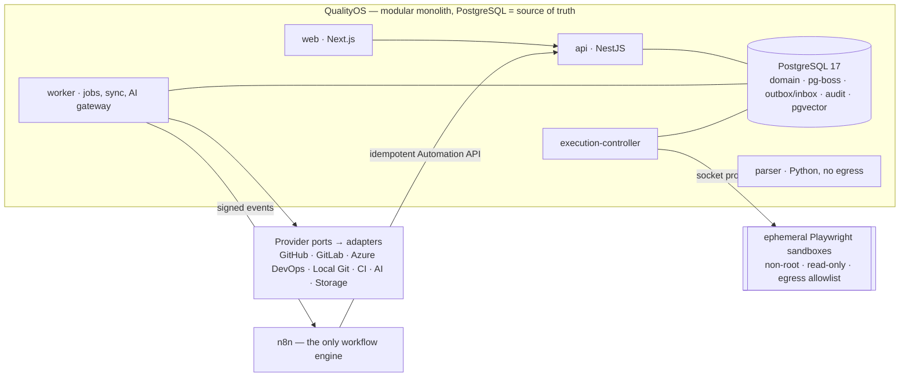

# QualityOS — Planning Package

> **Status: PLANNING COMPLETE. Nothing is implemented yet.** Every feature in this package is *planned*. Implementation starts only after the owner explicitly approves it ([37](37-implementation-kickoff.md)). · Last updated: 2026-11-09

## What QualityOS is
QualityOS is a provider-agnostic, AI-assisted quality engineering platform for QA/QC teams working across many projects. It connects these steps into one traceable record:
- requirements, from Azure Boards, Word, PDF, Excel, or manual entry
- AI-assisted test design
- manual testing
- sandboxed automated testing with Playwright
- visual regression
- failure analysis and defect handling, synced to Azure Boards, GitHub, GitLab, or the internal tracker
- fix verification
- explained quality metrics

It runs fully on one machine for a personal pilot (GitHub, Azure Boards, local n8n, Gemini as the pilot AI provider per ADR-0019). The company deployment (GitLab, Azure Boards, many QA teams) uses the same architecture.

## Architecture at a glance

- **Style:** a modular monolith with hexagonal ports and adapters. One codebase runs as several processes ([07](07-system-architecture.md), [ADR-0001](adr/ADR-0001-modular-monolith.md)).
- **Providers:** every family sits behind a port with a capability manifest, and bindings are set per project. Switching provider keeps history intact ([11](11-provider-architecture.md), [12](12-provider-contracts.md)).
- **Orchestration:** n8n is the single workflow engine. The core owns state and runs a closed list of essential operations, plus a minimal fallback for scheduled and fix-retest runs. Slot claims prevent duplicates ([18](18-n8n-orchestration.md), [ADR-0017](adr/ADR-0017-orchestration-ownership.md)).
- **Execution:** the pg-boss queue is kept separate from browser execution. A dedicated controller runs hardened, ephemeral containers ([17](17-test-execution-engine.md), [ADR-0010](adr/ADR-0010-sandboxed-execution.md)).
- **AI:** bounded, versioned tasks run through a gateway that handles redaction, budgets, schema validation, and evals. Humans approve every authoritative change ([15](15-ai-agent-architecture.md)).

## How the documentation is organized
| Group | Documents |
|---|---|
| Product | [01 Executive summary](01-executive-summary.md) · [02 Vision](02-product-vision.md) · [03 Business requirements](03-business-requirements.md) · [04 Personas & journeys](04-personas-and-user-journeys.md) · [05 Functional requirements (index)](05-functional-requirements.md) · [06 NFRs](06-non-functional-requirements.md) |
| Modules | [M01 Dashboard](modules/M01-company-dashboard.md) · [M02 Projects](modules/M02-project-management.md) · [M03 Integration Hub](modules/M03-integration-hub.md) · [M04 Requirements](modules/M04-requirements-intelligence.md) · [M05 AI Test Studio](modules/M05-ai-test-studio.md) · [M06 Manual Workspace](modules/M06-manual-testing-workspace.md) · [M07 Test Generation](modules/M07-automated-test-generation.md) · [M08 Execution Center](modules/M08-test-execution-center.md) · [M09 Visual](modules/M09-visual-regression.md) · [M10 Defect Intelligence](modules/M10-defect-intelligence.md) · [M11 Automation Center](modules/M11-automation-center.md) · [M12 Reports](modules/M12-reports-analytics.md) · [M13 Team & Permissions](modules/M13-team-permissions.md) · [M14 Security/Audit/Settings](modules/M14-security-audit-settings.md) |
| Architecture | [07 System architecture](07-system-architecture.md) · [08 Technology decisions](08-technology-decisions.md) · [09 Domain model](09-domain-model.md) · [10 Database design](10-database-design.md) · [11 Provider architecture](11-provider-architecture.md) · [12 Provider contracts](12-provider-contracts.md) · [13 Integration design](13-integration-design.md) · [ADRs](adr/README.md) |
| Engines & workflows | [14 Requirements engine](14-requirements-engine.md) · [15 AI architecture](15-ai-agent-architecture.md) · [16 Test management](16-test-management-engine.md) · [17 Test execution](17-test-execution-engine.md) · [18 n8n orchestration](18-n8n-orchestration.md) · [19 Workflow specifications](19-workflow-specifications.md) |
| Cross-cutting | [20 UI/UX](20-ui-ux-architecture.md) · [21 Security](21-security-architecture.md) · [22 Observability & reliability](22-observability-and-reliability.md) · [23 Local deployment](23-local-deployment.md) · [24 Testing strategy](24-testing-strategy.md) |
| Delivery | [25 Roadmap](25-implementation-roadmap.md) · [26 Task breakdown](26-task-breakdown.md) · [27 Pilot plan](27-pilot-validation-plan.md) · [28 Enterprise rollout](28-enterprise-rollout.md) · [29 Business case & KPIs](29-business-case-and-kpis.md) · [30 Risks](30-risks-and-mitigations.md) · [32 Acceptance matrix](32-acceptance-criteria-matrix.md) · [33 Compatibility matrix](33-provider-compatibility-matrix.md) |
| Reference & control | [31 Assumptions & open decisions](31-assumptions-and-open-decisions.md) · [34 Glossary](34-glossary.md) · [35 Planning audit](35-planning-audit.md) · [36 Technical validation & references](36-technical-validation.md) · [37 Implementation kickoff](37-implementation-kickoff.md) |

**Deviations from the suggested structure:**
- Module specs live in `modules/` so that `05` stays usable.
- ADRs live in `adr/`.
- Three files were added: `35` (audit), `36` (validated facts vs assumptions), and `37` (kickoff instructions).
- Content is cross-linked rather than duplicated.

## Recommended reading order
1. **Everyone:** 01 → 02 → 04 → this README's architecture section.
2. **Architects and engineers:** 07 → ADRs → 11 → 12 → 09 → 10 → 17 → 18 → 15 → 21 → 22.
3. **Product and QA:** 03 → 05 → modules M04, M05, M06, M08, M10 → 16 → 19 → 20 → 29.
4. **Implementers:** 25 → 26 → 32 → 24 → 23 → 36 → 37.
5. **Sponsors:** 01 → 27 → 28 → 29 → 30.

## Major architectural decisions
| Decision | Record |
|---|---|
| Modular monolith (not microservices), multi-process | [ADR-0001](adr/ADR-0001-modular-monolith.md) |
| Hexagonal ports + capability manifests; no provider names in core | [ADR-0002](adr/ADR-0002-hexagonal-capabilities.md) |
| TypeScript monorepo, NestJS backend, Next.js UI-only | [ADR-0003](adr/ADR-0003-typescript-monorepo.md), [ADR-0004](adr/ADR-0004-nestjs-backend.md), [ADR-0016](adr/ADR-0016-nextjs-ui-only.md) |
| PostgreSQL 17 + Drizzle; outbox/inbox; pg-boss (no Redis) | [ADR-0005](adr/ADR-0005-postgres-drizzle.md), [ADR-0007](adr/ADR-0007-outbox-inbox.md), [ADR-0006](adr/ADR-0006-pg-boss-queue.md) |
| n8n as the single, replaceable workflow engine; core essential ops + minimal fallback | [ADR-0008](adr/ADR-0008-n8n-orchestrator.md), [ADR-0017](adr/ADR-0017-orchestration-ownership.md) |
| Sandboxed execution via dedicated controller; TestEngine vs ExecutionBackend | [ADR-0010](adr/ADR-0010-sandboxed-execution.md), [ADR-0018](adr/ADR-0018-test-engine-vs-execution-backend.md) |
| Tests in a dedicated QA repo by default; PR-only writes | [ADR-0009](adr/ADR-0009-test-code-location.md) |
| AI as bounded tasks behind a gateway with approvals | [ADR-0012](adr/ADR-0012-ai-gateway-bounded-tasks.md) |
| Local FS → S3-compatible storage; MinIO rejected | [ADR-0011](adr/ADR-0011-object-storage.md) |
| Polling-first ingress; webhooks optional | [ADR-0014](adr/ADR-0014-polling-first-ingress.md) |
| Python parser sidecar (library chosen in P0) | [ADR-0013](adr/ADR-0013-python-parser-sidecar.md) |
| Local accounts first, OIDC-ready | [ADR-0015](adr/ADR-0015-authentication.md) |

## Current planning status
| Item | Status |
|---|---|
| Planning documents (product, modules, architecture, engines, cross-cutting, delivery) | ✅ Complete |
| Independent audit, with fixes applied | ✅ Complete ([35](35-planning-audit.md)) |
| Technical facts validated from official sources | ✅ Recorded with dates ([36](36-technical-validation.md)). 6 Phase 0 spikes outstanding |
| Implementation | ⛔ Not started. Awaiting owner approval |

## What remains unresolved
- **Company-blocking:** OD-01 (is n8n's Sustainable Use License acceptable for company use?) and OD-08 (AI data-processing approval).
- **P1-blocking, resolved in P0:** OD-02 (parser library) and OD-09 (NestJS 11 vs 12).
- **Unverified facts:** n8n CE public API and health endpoints (N5/N6), GitLab delivery-ID header (G2), embedding provider choice (T-P0-06), and `--shm-size` sufficiency (AS-07).
- The full list is in [31](31-assumptions-and-open-decisions.md) and [35 §6–7](35-planning-audit.md).

## Next recommended step
After explicit approval, start **Phase 0** (spikes T-P0-01…06) as described in [37 §4](37-implementation-kickoff.md). Begin with version pinning (T-P0-05) and the sandbox stability spike (T-P0-04), which is the highest technical risk.
